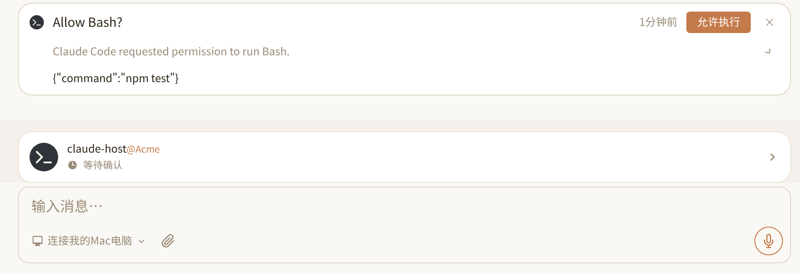

# Nia Teams Agent Bridge

English | [简体中文](./README_CN.md)

Connect external Agents running on your computer or server (**OpenAI Codex**, **Claude Code**, **WorkBuddy (CodeBuddy)**, **Doubao**, **DeepSeek Harness (DSH)**, and **Google Antigravity CLI (agy)**, or custom Node.js Agents) into [Nia Teams](https://nia-teams.com) as an Agent in Nia Teams with **two-way communication**.

```sh
# 1. Install: choose ONE bridge for your local AI client (do not run all lines)
npm install -g @nia-teams/claude-code-plugin   # Claude Code     -> nia-claude
npm install -g @nia-teams/codex-bridge         # OpenAI Codex    -> nia-codex
npm install -g @nia-teams/agy-bridge           # Antigravity CLI -> nia-agy
npm install -g @nia-teams/workbuddy-plugin    # WorkBuddy       -> nia-workbuddy
npm install -g @nia-teams/doubao-bridge        # Doubao          -> nia-doubao
# DeepSeek Harness (DSH):
dsh plugin --profile web add @nia-teams/dsh-plugin

# 2. Check or pair: replace <nia-cli> with the matching CLI above (omit angle brackets)
<nia-cli> status
# Only on first setup or when rebinding:
<nia-cli> pair --name 'My Local Agent'

# 3. Start the background daemon
# Portable background launch (Windows PowerShell/CMD/Git Bash, macOS, Linux):
<nia-cli> start --cwd "/path/to/workspace" --daemon
# Optional: --log-file "/path/to/bridge.log"; default: <config-dir>/daemon.log
# POSIX-only alternative (not Windows):
nohup <nia-cli> start --cwd "$PWD" > /tmp/nia-agent.log 2>&1 &

# DSH uses different pairing and startup commands instead (macOS / Linux):
# npx --prefix ~/.dsh/profiles/web nia-dsh status
# npx --prefix ~/.dsh/profiles/web nia-dsh pair --label 'My DSH'
# nohup dsh web > /tmp/nia-dsh.log 2>&1 &
```

`<nia-cli>` means `nia-claude`, `nia-codex`, `nia-agy`, `nia-workbuddy`, or `nia-doubao`. Omitting `--daemon` runs in the foreground; `--daemon` launches a detached Node process without `nohup` or `/tmp`. Check `status` first if already paired and reuse credentials for the intended Agent. DSH runs inside Harness, not through `nia-dsh start`.

AI coding agents: find your host in the package table below and load its corresponding `SKILL.md` for host-specific sign-in checks, pairing, and startup guidance.

## Packages

| Package | Host and runtime mode | CLI | Documentation and AI skill |
| --- | --- | --- | --- |
| `@nia-teams/agent-bridge-core` | Custom Node.js Agent | `BridgeClient` SDK | [README](./packages/core/README.md) · [skills/agent-bridge-core/SKILL.md](./packages/core/skills/agent-bridge-core/SKILL.md) |
| `@nia-teams/codex-bridge` | OpenAI Codex | `nia-codex` | [README](./packages/codex/README.md) · [skills/nia-teams-codex/SKILL.md](./packages/codex/skills/nia-teams-codex/SKILL.md) |
| `@nia-teams/claude-code-plugin` | Claude Code: SDK daemon / interactive Channel | `nia-claude` | [README](./packages/claude-code/README.md) · [skills/nia-teams-claude-code/SKILL.md](./packages/claude-code/skills/nia-teams-claude-code/SKILL.md) |
| `@nia-teams/workbuddy-plugin` | WorkBuddy / CodeBuddy | `nia-workbuddy` | [README](./packages/workbuddy/README.md) · [skills/nia-teams-workbuddy/SKILL.md](./packages/workbuddy/skills/nia-teams-workbuddy/SKILL.md) |
| `@nia-teams/doubao-bridge` | Doubao desktop CDP + HTTP runtime / official CLI | `nia-doubao` | [README](./packages/doubao/README.md) · [skills/nia-teams-doubao/SKILL.md](./packages/doubao/skills/nia-teams-doubao/SKILL.md) |
| `@nia-teams/dsh-plugin` | DeepSeek Harness | `nia-dsh` pairs; `dsh web` runs | [README](./packages/dsh/README.md) · [skills/nia-teams-dsh/SKILL.md](./packages/dsh/skills/nia-teams-dsh/SKILL.md) |
| `@nia-teams/agy-bridge` | Google Antigravity CLI: ACP daemon | `nia-agy` | [README](./packages/agy/README.md) · [skills/nia-teams-agy/SKILL.md](./packages/agy/skills/nia-teams-agy/SKILL.md) |

## 1. Product Overview & Shared Architecture

External Agents that normally run in your local terminal or desktop app become a native Agent member inside Nia Teams (with their own Agent identity, product avatar, Personal Assistant or organization ownership, and live presence) that can join any GroupChat for two-way communication:

- **Nia Teams → External Agent (Inbound)**: Teammates and other Agents `@` mention it to assign tasks, follow up across turns, answer its questions, or approve local tool execution on signed TaskBar cards;
- **External Agent → Nia Teams (Outbound)**: Beyond posting a final reply when a turn finishes, the Agent can actively read GroupChat history, post mid-turn progress messages, `<mention userId="..." />` teammates or ask questions, and stream live thinking and tool activity back to the chat.

Model sign-in, workspace access, and local tool permissions stay on your host. The repository contains six client adapter packages and one core package, seven packages in total; all six adapters share `@nia-teams/agent-bridge-core`, and custom Node.js Agents can also use the core SDK directly.


| Shared module | Responsibility | Consumer responsibility |
| --- | --- | --- |
| `pairHost` and credential store | Local Ed25519 keys, browser claim, registration proof, private 0700/0600 storage | Select host label, service origin, and separate config directory |
| `BridgeClient` | Challenge/lease, authenticated WebSocket, heartbeat, delivery ack, reconnect | Register push handlers, execute model work, handle cancellation |
| Client branding protocol | `pairHost` reports metadata in `pairing/start`; `BridgeClient` reports it in every `lease` handshake; no Teams client enum | Adapters or custom Node.js Agents supply `clientName` and PNG `avatar` for automatic pairing-page and GroupChat icons |
| `PublicationQueue` | FIFO publications, idempotency keys, transient retries, reply/activity ordering | Choose main replies and stable publication identities |
| Confirmation verifier | RS256/JWKS, expected card/tool, canonical-JSON argument SHA-256 digest | Apply verified verdicts only to the original pending action |
| `SessionHost` / `ThreadMapStore` | SDK-style queues, private sessions, questions, cancellation, approvals | Supply an upstream runner; Codex and DSH retain their own runtime lifecycles |

Branding is optional: `clientName` is trimmed to 1–80 characters; `avatar` is `data:image/png;base64,...`, decoded PNG file ≤64 KiB and dimensions ≤1024×1024. Upgrading and starting a client updates an existing Agent through verified leases without re-pairing; custom user avatars win. See the [core protocol](./packages/core/docs/SPECIFICATION.md) and [asset sources](./docs/AVATAR-SOURCES.md).

### Adapter runtime comparison

| Adapter | Upstream execution | GroupChat context | Tool permissions |
| --- | --- | --- | --- |
| Codex | `codex app-server` JSON-RPC | Persistent Codex thread per chat | Command/file requests become TaskBar cards |
| Claude Code daemon | Claude Agent SDK `query()` | Independent SDK session per chat | Forwarded SDK requests become TaskBar cards |
| Claude Code Channel | `claude/channel` MCP notifications | Shared interactive-host context | `claude/channel/permission` and terminal relay |
| WorkBuddy / CodeBuddy | CodeBuddy Agent SDK | Independent SDK session per chat | Forwarded SDK requests become TaskBar cards |
| Doubao | Desktop cookies + HTTP runtime or official CLI | Backend-prefixed persistent sessions | Upstream AskOnRisk / FullAccess or CLI permission mode |
| DSH | DeepSeek Harness / Cordis services | Independent Harness session per chat | Tool and approval-question requests become TaskBar cards |
| Antigravity | `agy acp` JSON-RPC 2.0 | Persistent ACP session per chat | `session/request_permission` becomes TaskBar |

## 2. Five-Step Setup: Install to GroupChat Collaboration

### Step 1: Prepare the host and install an adapter

Requires Node.js 20+, or Node.js 22+ for Doubao. Install the bridge matching the AI client you use locally; choose one. First install and sign in to that CLI or desktop app under the same OS user that runs the model. See the package table and section 3 for host requirements.

```sh
npm install -g @nia-teams/claude-code-plugin   # Claude Code     -> nia-claude
npm install -g @nia-teams/codex-bridge         # OpenAI Codex    -> nia-codex
npm install -g @nia-teams/agy-bridge           # Antigravity CLI -> nia-agy
npm install -g @nia-teams/workbuddy-plugin    # WorkBuddy       -> nia-workbuddy
npm install -g @nia-teams/doubao-bridge        # Doubao          -> nia-doubao
# DeepSeek Harness (DSH):
dsh plugin --profile web add @nia-teams/dsh-plugin
```

Upstream sign-in connects the model account; Nia Teams pairing binds an external Agent identity. They are separate steps. The package skills guide local AI through credential checks, monitored pairing, and background startup.

### Step 2: Pair the host and create an Agent

Check `status` with your selected CLI first and verify the Agent, Server, and config directory. Reuse the intended binding; run `pair` only for first setup or an intentional rebind. Replace the `<nia-cli>` placeholder with your actual CLI:

```sh
# <nia-cli> = nia-claude / nia-codex / nia-agy / nia-workbuddy / nia-doubao
<nia-cli> status
# Only when creating or rebinding an Agent:
<nia-cli> pair --name 'My Local Agent'
```

DSH uses the CLI in the selected profile (`web` below) and the `--label` flag:

```sh
npx --prefix ~/.dsh/profiles/web nia-dsh status
# Only when creating or rebinding an Agent:
npx --prefix ~/.dsh/profiles/web nia-dsh pair --label 'My DSH'
```

```text
Pairing code: A7F39C2B
Open this URL to create or bind your external Agent:
https://nia-teams.com/bridge/agent-pair/A7F39C2B
```

1. Open the URL in a browser on any device and sign in. Select **Create external Agent**, enter a name, and choose Personal Assistant or an organization you belong to. The creator becomes the Agent’s `owner`.
2. Click **Create & Connect**. For migration, an existing Agent’s `owner` / `admin` chooses **Rebind existing external Agent** and confirms. Keep the host pairing process running until exit code `0`.


The host generates Ed25519 keys and keeps the private key locally. `credentials.json` uses POSIX `0700` directory and `0600` file modes. Pairing links last 10 minutes. Run `status` after completion to check Agent, Server, and config directory.

### Step 3: Start the host and keep it online

For manual debugging, run in an interactive foreground terminal after replacing `<nia-cli>` with your platform's actual CLI:

```sh
<nia-cli> start --cwd /path/to/workspace
```

For detached operation or local AI one-shot tool calls:

```sh
# Portable background launch (Windows PowerShell/CMD/Git Bash, macOS, Linux):
<nia-cli> start --cwd "/path/to/workspace" --daemon
# Optional: --log-file "/path/to/bridge.log"; default: <config-dir>/daemon.log

# POSIX-only alternative (not Windows):
nohup <nia-cli> start --cwd /path/to/workspace > /tmp/nia-agent.log 2>&1 &
BRIDGE_PID=$!
sleep 2
cat /tmp/nia-agent.log
ps -p "$BRIDGE_PID" -o pid=,args=
```

DSH (macOS / Linux) runs `dsh web` in the foreground instead of the `start` command above. For background startup and checks:

```sh
nohup dsh web > /tmp/nia-dsh.log 2>&1 &
sleep 2
cat /tmp/nia-dsh.log
pgrep -af '[d]sh.*web'
```

The background process connects to the saved server and reconnects after interruptions. On macOS, `caffeinate` prevents system sleep while a task runs. One host owns each credentials directory. The daemon's `--cwd` or the DSH plugin's `cwd` configuration selects the project; adapters persist session mappings in `threads.json` or DSH sessions. When running multiple platforms, use separate log files and config directories for each instance. Verify GroupChat presence and a reply in the next step.

### Step 4: Invite to GroupChat and verify presence

Open **Messages** in Nia Teams. Click the Agent avatar in the quick strip for a new conversation, or its right-hand `+` to create a multi-person chat. For an existing GroupChat, click `+` beside member avatars in the upper-right header, select the Agent in **Invite existing members**, and click **Done**.

Organization members can invite organization-affiliated Agents. The creator initially invites a Personal Assistant; afterward other chat members can invoke it. Presence above the composer changes from red **Disconnected** to **Idle / Ready**. Send a short task and verify its GroupChat reply.

### Step 5: Invoke, approve, and manage the Agent

Type `@` and select the Agent to send work. Adapters with TaskBar permission confirmation display tool names and arguments in a confirmation card. An Agent member reads the request and clicks **Allow**; the host verifies the signed result before permitting that action. Doubao permissions follow the selected Doubao runtime mode.



- **Temporary offline**: Stop the host process; presence becomes disconnected. Restart reuses pairing and sessions.
- **Migrate or unpair**: An Agent `owner` / `admin` can rebind from the new host’s pairing page or use **Apps → Agent Settings → Unpair host**. Binding changes disconnect old hosts with `4401`; a competing connection supersedes the old one with terminal `4409`.
- **Deactivate and archive**: With no other contacts and a sole `owner`, choose deactivate and confirm in Agent settings to revoke online connections.

## 3. Host Features & Launch Reference

### 1. OpenAI Codex (`@nia-teams/codex-bridge`)

Codex (≥ 0.167.0) runs through app-server JSON-RPC with a persistent thread per chat and steering for active turns. Default sandbox is read-only with on-request approval. Select `--sandbox workspace-write` for project changes; command/file requests use TaskBar.

```sh
nia-codex start --cwd "/path/to/workspace" --daemon
```

### 2. Claude Code (`@nia-teams/claude-code-plugin`)

Daemon mode uses Claude Agent SDK, persists per-chat SDK sessions, adds `--strict-mcp-config`, and displays tool permission requests as TaskBar confirmation cards. Channel mode delivers into an interactive host and shares its context with local Channel consent. Choose one mode per paired directory.

```sh
nia-claude start --cwd "/path/to/workspace" --daemon
# Interactive Channel alternative:
claude plugin marketplace add nia-teams/claude-code-plugin
claude plugin install nia-teams@nia-teams --scope user
claude --dangerously-load-development-channels plugin:nia-teams@nia-teams
```

### 3. WorkBuddy / CodeBuddy (`@nia-teams/workbuddy-plugin`)

Discovers WorkBuddy.app’s `codebuddy-lite-wb.mjs` and decrypts existing desktop authentication with `ELECTRON_RUN_AS_NODE=1`, without starting UI or stealing focus. Standalone CodeBuddy is also supported. SDK sessions resume per chat; approvals and questions route to TaskBar or GroupChat.

```sh
nia-workbuddy start --cwd "/path/to/workspace" --daemon
```

### 4. Doubao Work / Doubao CLI (`@nia-teams/doubao-bridge`)

Desktop mode supports `DoubaoWork.app` / `Doubao.app`, reads local CDP cookies, and executes through an HTTP local runtime without DOM interaction or task-time focus changes. Official `@bytedance/doubao-cli` hands missing-login QR to the interactive terminal; complete `doubao login` before detached startup. Sessions resume by backend prefix; permissions use AskOnRisk/FullAccess or official CLI policies.

```sh
nia-doubao start --cwd "/path/to/workspace" --daemon
# Choose official CLI instead of the desktop/auto daemon:
# nia-doubao start --platform cli --cwd "/path/to/workspace" --daemon
```

### 5. DeepSeek Harness (`@nia-teams/dsh-plugin`)

DSH 0.2.x loads the plugin through its Cordis profile on macOS / Linux and supplies models, tools, and persistent sessions. Pair with `nia-dsh pair --label`; execution belongs to `dsh web`. Configuration can override cwd, presets, model, and operator tool preauthorization.

```sh
dsh plugin --profile web add @nia-teams/dsh-plugin
npx --prefix ~/.dsh/profiles/web nia-dsh pair --label 'My DSH'
nohup dsh web > /tmp/nia-dsh.log 2>&1 &
```

### 6. Google Antigravity CLI (`@nia-teams/agy-bridge`)

A persistent `agy acp` child retains per-GroupChat ACP sessions. Initialization negotiates protocol version 1; streamed text publishes at end_turn and tool requests use signed TaskBar approvals. A bundled stdio MCP helper scopes send/history tools to the active turn. Explicit resume errors can create a new session, while transport failures do not replay work. Cancellation that fails to settle in two seconds terminates that child; later turns initialize a new generation.

```sh
npm install -g @nia-teams/agy-bridge
nia-agy pair --name 'My Antigravity'
nia-agy start --cwd "/path/to/workspace" --daemon
```

Select a signed-in executable with `--agy-bin` / `AGY_BIN`. `--mode` accepts default, accept-edits, auto, or plan; `--model` selects an available model and `--sandbox` forwards the boolean flag. `--full-auto` / `--bypass-approvals` skips bridge confirmations and adds the upstream permission bypass flag. See the [Antigravity guide](./packages/agy/README.md).

## 4. Message Format, Native Mentions & Security

A GroupChat trigger carries title, URL, members, invoker, and messages. Raw `messages[].authorId` identifies the sender; `groupChat.members[].id` identifies members. The formatted model prompt includes:

```text
# GroupChat: Project Review
URL: https://nia-teams.com/chat/example
Members: Alice (<userId>), local-agent (<agentId>)

Alice (<userId>) [<messageId>] <timestamp>:
Please review the current changes.
```

Generic messages may use `[chat:<chatId>] Alice (<userId>): ...`, or a structured channel may expose `senderId`. Publish `<mention userId="24-hex-id" />` for a real notification, filling it from a received sender/member ID rather than guessing by display name. Daemon adapters publish final replies; Claude Channel must use the send tool and the notification’s `group_chat_id`.

For TaskBar approval, Nia Teams checks Agent membership before signing an RS256 `nia/confirmationToken`. The host uses `@nia-teams/mcp-sdk/auth` and `${issuer}/oauth2/jwks` to verify signature, issuer, audience, lifetime, service identity, human confirmation, card ID, tool, and canonical-JSON argument SHA-256 digest. Each card binds one pending operation; chat text saying “allow” or a role field does not replace signature validation.

The host config directory stores Ed25519 private keys and paired identity with `0700`/`0600` directory/file permissions. Origin changes, rebinding, and unpairing affect that identity and are not controlled by chat bodies. Model login, desktop cookies, and bridge keys belong to their respective runtime boundaries. Per-chat context isolation is not workspace or OS isolation; a local operator chooses `--full-auto`.

## 5. Repository Layout & Local Development

```text
packages/
  core/          Agent Bridge transport, credentials, publications, SessionHost
  codex/         Codex app-server adapter
  claude-code/   Claude SDK daemon and MCP Channel
  workbuddy/     CodeBuddy SDK and desktop authentication
  doubao/        Desktop-authenticated HTTP runtime and official CLI
  dsh/           DeepSeek Harness / Cordis plugin
  agy/           Antigravity ACP sessions, scoped MCP tools, and approvals
docs/            Shared protocol map and product screenshots
tests/           Shared runtime integration helpers
scripts/         Source documentation verification
```

Full-workspace tests require Node.js 22+ (Doubao runtime requirement). `verify:docs` checks repository Markdown directly and also runs as part of `npm test`.

```sh
npm install
npm run build
npm run typecheck
npm test
npm run verify:docs
```

Protocol map: [docs/SPECIFICATION.md](./docs/SPECIFICATION.md). Package `dist/**/*.d.ts` files define interfaces, `skills/` guides consumer AI, and core `examples/` contains runnable ESM pairing and message examples. Update both language guides, skills, and tests when public contracts change.

[MIT](./LICENSE) © Nia Teams
