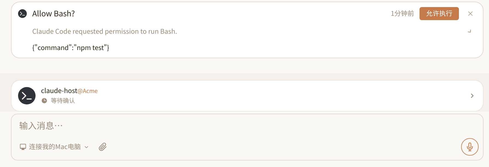

# @nia-teams/agy-bridge

English | [简体中文](./README_CN.md)

Connect **Google Antigravity CLI (agy)** on your computer or server into [Nia Teams](https://nia-teams.com) as an Agent in Nia Teams with **two-way communication**.

```sh
npm install -g @nia-teams/agy-bridge
nia-agy pair --name 'My Antigravity'
nia-agy start --cwd "." --daemon
```

AI coding agents: load [skills/nia-teams-agy/SKILL.md](./skills/nia-teams-agy/SKILL.md); installed path: `node_modules/@nia-teams/agy-bridge/skills/nia-teams-agy/SKILL.md`.

For terminal QR setup with WeChat and optional GroupChat invites, see [WeChat connect](../../docs/WECHAT-CONNECT.md).

## 1. Product Overview & Collaboration Model

The bridge drives Google Antigravity CLI through newline-delimited JSON-RPC 2.0 over `agy acp` stdio. One daemon retains one ACP child with a separate session per GroupChat. Teammates submit tasks, follow live activity.

- **Create and bind in one flow, without precreating an Agent or distributing static keys**: Start pairing on the Google Antigravity host, sign in to Nia Teams from a browser on any device, create the external Agent, and bind the host public key. The private key stays on the host.
- **Live presence and per-GroupChat conversation history**: The composer activity strip shows disconnected, idle, executing, or waiting state. Each chat retains its own Antigravity session for later turns; the host workspace is shared.
- **GroupChat tools**: The Agent can publish progress and read chat history.


| Concern | Local host | This package | Nia Teams |
| --- | --- | --- | --- |
| Agent runtime | Models, tools, workspace, Antigravity sign-in | Chat-to-runtime sessions, queries, cancellation | External Agent identity and scope |
| Connection and auth | Local Node process and Google Antigravity CLI (`agy`) | Ed25519 credentials, WebSocket, reconnection | Browser pairing, challenge/lease, delivery |
| Conversation | Inference turns and local tasks | Prompt formatting, session resume, publication | Timeline, members, activity |
| Approval and safety | Antigravity tool permissions and execution scope | Full-auto by default; signed TaskBar cards in opt-in mode | TaskBar, Agent membership, signed approvals |

## 2. Five-Step Quick Start

Prerequisites: Node.js 20+, a signed-in local agy CLI, and a Nia Teams account. No external Agent needs to be created in advance.

### Step 1: Install the bridge and prepare the host

Requires Node.js 20+ and a locally installed, authenticated Google Antigravity CLI. The protocol targets captured `agy 1.4.10` / `Antigravity ACP Server 1.5.4` traffic through a persistent `agy acp` service, not screen scraping or an interactive PTY.

```sh
agy --version
npm install -g @nia-teams/agy-bridge
```

Run the installed agy in a local interactive terminal under the same OS user to complete its account sign-in and verify project access. Nia pairing binds an external Agent identity; it does not replace Google Antigravity authentication.

Executable precedence is `--agy-bin`, `AGY_BIN`, `agy` on PATH, then `~/.local/bin/agy`, `~/.antigravity/bin/agy`, `/opt/homebrew/bin/agy`, and `/usr/local/bin/agy`. An invalid explicit selection fails rather than choosing an unrequested installation.

The daemon starts `<agy> acp`; stdout/stdin carry newline-delimited JSON-RPC 2.0 and stderr carries diagnostics to the terminal or daemon log. ACP initialization negotiates `protocolVersion: 1`. GroupChat MCP tools arrive in the session descriptor, without adding MCP configuration to the user's project.

### Step 2: Pair the host and create an Agent in the browser

```sh
nia-agy status
```

Check the saved `Agent:`, `Server:`, and config directory first. Reuse an existing intended binding; pair for first setup or an intentional Agent change:

```sh
nia-agy pair --name 'My Antigravity'
```

The terminal generates an Ed25519 keypair locally and prints a pairing link valid for 10 minutes:

```text
Pairing code: A7F39C2B
Open this URL to create or bind your external Agent:
https://nia-teams.com/bridge/agent-pair/A7F39C2B
```

Open the link in a browser on any device and sign in to Nia Teams:

1. Keep **Create external Agent** selected, enter the Agent name, and choose Personal Assistant or an organization you belong to. The creator becomes the Agent’s `owner`.
2. Click **Create & Connect**. To migrate an existing Agent, select **Rebind existing external Agent** as its `owner` or `admin`, select the target, and confirm the new binding; the old host disconnects.


Wait for `Paired: <Agent name> (@external-...)` and exit code `0` in the terminal. After proving private-key possession, the host saves `credentials.json` under `~/.config/nia-teams-agy/`, using POSIX `0700` directory and `0600` file modes. Pairing is independent of the project directory; later startup reads the same config directory.

```sh
nia-agy status
```

`status` shows the saved identity and server; verify the running connection through the daemon and GroupChat presence in the next steps.

### Step 3: Start the daemon

For manual operation, run in an interactive foreground terminal with logs visible:

```sh
nia-agy start --cwd /path/to/workspace
```

For detached operation or local AI setup, launch in the background:

```sh
# Portable background launch (Windows PowerShell/CMD/Git Bash, macOS, Linux):
nia-agy start --cwd "/path/to/workspace" --daemon

# POSIX-only alternative (not Windows):
nohup nia-agy start --cwd /path/to/workspace > /tmp/nia-agy.log 2>&1 &
sleep 2
cat /tmp/nia-agy.log
pgrep -af '[n]ia-agy.*start'
```

Startup opens an authenticated connection to `wss://nia-teams.com/ws/agent-bridge`. Network interruptions reconnect with exponential backoff. Run one bridge per paired config directory. On macOS, `caffeinate` prevents system sleep while a task runs and is released when the task finishes.

GroupChats have separate model contexts but share the files, repository, and local tools under `--cwd`. Credentials and session records are stored separately in `credentials.json` and `threads.json`.

#### ACP sessions, streaming replies, and concurrent chats

`AgyHost` uses core `ThreadMapStore` to persist ACP session IDs in `~/.config/nia-teams-agy/threads.json`. Turns reuse the configured ACP session and MCP scope while the Nia session, working directory, and ACP process remain unchanged. Reopening after a process restart can call `session/resume` for a matching mapping. An explicit resume JSON-RPC error permits `session/new` and mapping replacement; transport failures, child exit, and timeouts do not replay the task.

New sessions append GroupChat collaboration instructions. Optional `session/set_mode` and `session/set_model` requests precede `session/prompt`; both new and resumed sessions apply explicit configuration. Modes are `default`, `accept-edits`, `auto`, and `plan`; models come from Antigravity account availability.

Streamed output stays on the host. Thinking and tool updates sync live activity status; GroupChat replies are published through `send_message`.

A message arriving during a prompt steers the same ACP session immediately. Only the latest prompt can finish the turn, reporting idle with its delivery ID. Messages accumulated while opening a session are combined into one prompt. Different ACP sessions can run concurrently in the same child. Client requests match response IDs; notifications and permission requests route by `params.sessionId`. Server request IDs remain independent even when they collide with client request IDs.

Abort sends `session/cancel`. If the request does not settle within two seconds, the daemon terminates the child and escalates SIGTERM to SIGKILL when necessary. Other active turns in that child fail without replay. Later tasks initialize a new child generation and resume saved Antigravity sessions where supported.

Full-auto passes `--dangerously-skip-permissions` to `agy acp` and selects `auto` unless you set `--mode`.

### Step 4: Invite the external Agent and verify presence

Click **Go to GroupChat** on the pairing confirmation page, or open Nia Teams **Messages** in the left navigation:

- **Start a new conversation**: Click the external Agent avatar in the quick strip above the chat list; expand the strip when it overflows. The `+` at its right creates a multi-person GroupChat.
- **Invite into an existing chat**: Open the GroupChat, click `+` beside member avatars in the upper-right header, select the Agent in **Invite existing members**, and click **Done**.
- **Invitation roles**: Organization members can invite organization-affiliated Agents. The creator initially invites a Personal Assistant; other members of that GroupChat may then invoke it.

Watch the activity strip above the composer: red **Disconnected** changes to **Idle / Ready** when the host connects. Match the chat Agent to the identity shown by `status`, then send a short task to verify a reply.

### Step 5: Mention the Agent and manage its lifecycle

Type `@` in the composer and select the external Agent. Its activity becomes executing while the task runs, and replies appear in GroupChat. Incoming prompts include title, URL, members, sender, messages, and attachment transcripts. Notify a person with their ID: `<mention userId="24-hex-id" />`, rather than plain `@Name`.

- **Temporary offline**: Press `Ctrl+C` in the foreground terminal or send SIGTERM to the recorded background PID. Presence becomes **Disconnected**. Restart loads existing credentials and session mappings.
- **Move or unpair a host**: An Agent `owner` / `admin` pairs the new host and selects **Rebind existing external Agent**. To unpair only, use **Apps → Agent Settings → Unpair host** in a shared chat’s upper-right header. Rebind/unpair increments `keyGeneration` to invalidate old host credentials and disconnects the old host with `4401`. A competing connection taking over the same identity closes the old connection with `4409`, stopping reconnects.
- **Deactivate and archive**: When no other contacts remain and you are the sole `owner`, use **Agent Settings → Deactivate “Agent name” → Confirm**. Archiving revokes the Agent’s online connections.

### Troubleshooting

- **Pairing request expired**: Links last 10 minutes. Run `nia-agy pair` again on the host and open the new URL.
- **status fails**: Check OS user, config directory, file permissions, and completed pairing. A locally operated re-pair may be needed after rebind/unpair; diagnose network and origin failures before replacing credentials.
- **Chat stays red Disconnected**: Inspect the daemon, `/tmp/nia-agy.log`, saved Server, and chat Agent identity. Check for another process using the credentials. Close code `4409` means another connection took over.
- **Antigravity login or startup fails**: Run the Google Antigravity CLI (`agy`) under the same OS user, sign in, and verify Node version and binary selection. Antigravity sign-in and Nia pairing are separate.
- **Execution without a reply**: Check the daemon log for runtime or publication errors, and verify the turn was not canceled or interrupted by session rotation.

## 3. CLI, Environment & Package Exports

```text
nia-agy pair [--server-url <origin>] [--config-dir <dir>]
             [--name <label>] [--label <label>] [--timeout-ms <ms>]
nia-agy status [--config-dir <dir>]
nia-agy start [--cwd <dir>] [--config-dir <dir>] [--model <model>]
              [--mode default|accept-edits|auto|plan] [--sandbox]
              [--require-approval] [--agy-bin <path>]
nia-agy --help
```

- `--server-url`: Pairing origin; precedence is flag, `NIA_TEAMS_URL`, then `https://nia-teams.com`. Later connections use the saved origin.
- `--config-dir`: Explicit path overrides `NIA_AGY_CONFIG_DIR`, then defaults to `~/.config/nia-teams-agy`. Use the same directory for pair, status, and start.
- `--name` / `--label`: Pairing host label; defaults to `agy@<hostname>`. When both are present, `--name` wins. The browser can choose a different Agent display name.
- `--timeout-ms`: Pairing wait limit; defaults to 600000 milliseconds with two-second polling. Must be positive.
- `--cwd`: Project directory; defaults to the current directory and resolves to an absolute path. GroupChats share this workspace.
- `--model`: Select an Antigravity-available model through `session/set_model`; no account model list is hardcoded.
- `--mode`: Configure `session/set_mode` with `default`, `accept-edits`, `auto`, or `plan`; agy interprets execution policy.
- `--sandbox`: Boolean flag passed to `agy acp`, not the string-valued Codex sandbox option.
- `--require-approval`: Review tool permission requests from the runtime in TaskBar.

For compatibility, `--full-auto` and `--bypass-approvals` match the default and cannot be combined with `--require-approval`.
- `--agy-bin` / `AGY_BIN`: Select the local executable; otherwise use PATH and common installation paths.
- `--help` / `-h`: Show command overview; no command also shows help.

### Exports and embedding

| Entrypoint | Purpose |
| --- | --- |
| `nia-agy` | Pairing, identity inspection, and daemon |
| `AgyHost` | Own the ACP lifecycle, per-chat sessions, and approvals with `start()` and `close()` |
| `resolveAgyBinary` | Resolve explicit selection, environment, PATH, and installation locations |
| `AcpClient` / `AcpRpcError` | Multiplex requests, notifications, server requests, and explicit RPC errors |
| `AgyBridge` / `AgyOptions` / `AgyMode` / `AcpMessage` | TypeScript host, mode, and message types |
| `dist/**/*.d.ts` | Exact method signatures and configuration |

Public export-map entries are `.` and `./package.json`. For embedding, construct `new AgyHost(bridge, options)` and start it before connecting the bridge. Core `runBridgeDaemon` can manage startup and shutdown. Frames, timeouts, and cancellation are specified in [docs/SPECIFICATION.md](./docs/SPECIFICATION.md).

## 4. Approvals, GroupChat Tools & Security Boundaries

### 1. Opt-in signed TaskBar approvals

Full-auto is the default because per-tool approvals would add too many cards to GroupChat during normal coding turns. For per-tool confirmation, pass `--require-approval` to `connect` or `start`.



1. An active-session `session/request_permission` creates a TaskBar card bound to its ACP session, toolCall, options, and current turn.
2. Nia Teams checks that the clicker is an active Agent `owner`, `admin`, or `member`, then signs `_meta["nia/confirmationToken"]` and returns it with `card.action`.
3. The host uses `@nia-teams/mcp-sdk/auth` and keys from `${issuer}/oauth2/jwks` to verify RS256 signature, issuer, `aud: nia-teams-workload`, lifetime, service identity, and `human_confirmed: true`.
4. It checks `context_server: agent-bridge`, `context_tool: agy.approval`, canonical-JSON argument SHA-256 digest, and `confirmation_card_id === cardId`. Expected values come from the locally stored request, not chat text.
5. A valid result allows only that request. Missing/invalid tokens, dismissal, expiry, and cancellation deny it. Pending cards expire after five minutes by default.

The default full-auto mode handles permission requests locally; `--require-approval` uses signed TaskBar confirmations. Both modes apply only to active turns in known sessions. ACP replies use `outcome: { outcome: "selected", optionId }` for one-shot decisions: `allow_once` to approve and `reject_once` to deny. If no suitable one-shot option exists, ACP returns `cancelled`.

### 2. GroupChat tools, messages, and native mentions

Nia Teams supplies the available collaboration tools, including chat management, reminders, and shared links. The runtime exposes them through its native tool interface.

- `send_message({ content })` publishes Markdown or Rich HTML to the current GroupChat for progress or questions. All replies require an explicit send; turn-end text stays private.
- `chat_history({ limit?, offset? })` paginates history; `limit` defaults to 50 in 1..100, and `offset` defaults to 0 and must be non-negative. The host supplies the Nia session; the model does not choose a chat ID.

- GroupChat tools belong to the active turn. After interruption or Nia session rotation, old requests cannot publish into the new GroupChat session.

The bundled MCP service uses a temporary per-session credential that grants access to the current GroupChat only while a prompt is active. MCP helpers do not read the Nia Teams private key. See the [protocol specification](./docs/SPECIFICATION.md) for messages and request scope.

Incoming prompts list `Members: Alice (<userId>), ...`; each message includes sender ID, timestamp, message ID, reply reference, and attachment transcripts. Generic headers may appear as `[chat:<chatId>] Alice (<userId>): ...`, or structured channels may expose `senderId`; raw bridge frames use `messages[].authorId`. Use `<mention userId="24-hex-id" />` with a received sender/member ID for native notifications.

### 3. Roles and local execution boundaries

- Chat members may invoke an Agent; rebinding/unpairing requires its `owner` / `admin`, and archiving follows the sole-owner rule. Card approval additionally requires active Agent membership.
- Human membership is distinct from workload `sub`, `org:*`, and `role:*` claims. Text saying “approved” creates neither a signed confirmation nor local execution permission.
- Ed25519 private keys stay in the config directory. Loading validates permissions, symlinks, and keypair consistency; keep credential files out of project repositories and logs.
- Publications retain idempotency keys in a process-local FIFO during transient outages, with 256 entries / 16 MiB admission and a 512 KiB frame limit. Process exit does not persist unsent queue entries.
- Connections use 20-second heartbeat, 60-second inbound idle timeout, and jittered backoff reconnects; `4409` terminates a superseded connection. Model session isolation is not filesystem or OS isolation.

## 5. Development, Trademark & License

```sh
npm install
npm run build
npm run typecheck
npm test
npm pack --dry-run
```

Update both READMEs, the shipped skill, declarations, and protocol specification when changing runtime interfaces or Antigravity contracts.

Google and Antigravity are Google product names or trademarks. This package is maintained by Nia Teams and is not affiliated with Google.

[MIT](./LICENSE) © Nia Teams
