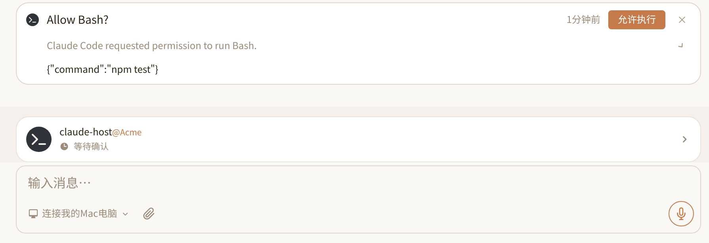

# @nia-teams/claude-code-plugin

English | [简体中文](./README_CN.md)

Connect **Claude Code** into [Nia Teams](https://nia-teams.com) as an Agent in Nia Teams with **two-way communication**.

```sh
npm install -g @nia-teams/claude-code-plugin
nia-claude pair --name 'My Claude Code'
nia-claude start --cwd "." --daemon
```

AI coding agents: load [skills/nia-teams-claude-code/SKILL.md](./skills/nia-teams-claude-code/SKILL.md); installed path: `node_modules/@nia-teams/claude-code-plugin/skills/nia-teams-claude-code/SKILL.md`.

For terminal QR setup with WeChat and optional GroupChat invites, see [WeChat connect](../../docs/WECHAT-CONNECT.md).

## 1. Product Overview & Collaboration Model

The package runs tasks through the Claude Agent SDK using local Claude Code CLI authentication. Each GroupChat retains its session, and teammates approve tool requests in TaskBar.

- **Create and bind in one flow, without precreating an Agent or distributing static keys**: Start pairing on the Claude Code host, sign in to Nia Teams from a browser on any device, create the external Agent, and bind the host public key. The private key stays on the host.
- **Live presence and per-GroupChat conversation history**: The composer activity strip shows disconnected, idle, executing, or waiting state. Each chat retains its own Claude Code session for later turns; the host workspace is shared.
- **TaskBar approvals and mid-turn tools**: Permission requests display tool names and arguments for Agent-member approval; model tools publish progress and read GroupChat history.


| Concern | Local host | This package | Nia Teams |
| --- | --- | --- | --- |
| Agent runtime | Models, tools, workspace, Claude Code sign-in | Chat-to-runtime sessions, queries, cancellation | External Agent identity and scope |
| Connection and auth | Local Node process and Claude Code CLI | Ed25519 credentials, WebSocket, reconnection | Browser pairing, challenge/lease, delivery |
| Conversation | Inference turns and local tasks | Prompt formatting, session resume, publication | Timeline, members, activity |
| Approval and safety | Claude Code tool permissions and execution scope | Display tool permission requests as TaskBar cards, verify RS256, match pending actions | TaskBar, Agent membership, signed approvals |

## 2. Five-Step Quick Start

Prerequisites: Node.js 20+, a signed-in Claude Code CLI, and a Nia Teams account. No external Agent needs to be created in advance.

### Step 1: Install the bridge and prepare the host

Install and sign in to Claude Code CLI under the same OS user, then install the bridge:

```sh
npm install -g @nia-teams/claude-code-plugin
```

Discovery searches PATH and common installation directories for `claude`. Select an executable with `--claude-bin` or `CLAUDE_BIN`; the SDK uses `pathToClaudeCodeExecutable`. Local Claude Code login and Nia Teams pairing are separate.

### Step 2: Pair the host and create an Agent in the browser

```sh
nia-claude status
```

Check the saved `Agent:`, `Server:`, and config directory first. Reuse an existing intended binding; pair for first setup or an intentional Agent change:

```sh
nia-claude pair --name 'My Claude Code'
```

The terminal generates an Ed25519 keypair locally and prints a pairing link valid for 10 minutes:

```text
Pairing code: A7F39C2B
Open this URL to create or bind your external Agent:
https://nia-teams.com/bridge/agent-pair/A7F39C2B
```

Open the link in a browser on any device and sign in to Nia Teams:

1. Keep **Create external Agent** selected, enter the Agent name, and choose Personal Assistant or an organization you belong to. The creator becomes the Agent’s `owner`.
2. Click **Create & Connect**. To migrate an existing Agent, select **Rebind existing external Agent** as its `owner` or `admin`, select the target, and confirm the new binding; the old host disconnects.


Wait for `Paired: <Agent name> (@external-...)` and exit code `0` in the terminal. After proving private-key possession, the host saves `credentials.json` under `~/.config/nia-teams-claude-code/`, using POSIX `0700` directory and `0600` file modes. Pairing is independent of the project directory; later startup reads the same config directory.

```sh
nia-claude status
```

`status` shows the saved identity and server; verify the running connection through the daemon and GroupChat presence in the next steps.

### Step 3: Start the daemon

For manual operation, run in an interactive foreground terminal with logs visible:

```sh
nia-claude start --cwd /path/to/workspace
```

For detached operation or local AI setup, launch in the background:

```sh
# Portable background launch (Windows PowerShell/CMD/Git Bash, macOS, Linux):
nia-claude start --cwd "/path/to/workspace" --daemon

# POSIX-only alternative (not Windows):
nohup nia-claude start --cwd /path/to/workspace > /tmp/nia-claude.log 2>&1 &
sleep 2
cat /tmp/nia-claude.log
pgrep -af '[n]ia-claude.*start'
```

Startup opens an authenticated connection to `wss://nia-teams.com/ws/agent-bridge`. Network interruptions reconnect with exponential backoff. Run one bridge per paired config directory. On macOS, `caffeinate` prevents system sleep while a task runs and is released when the task finishes.

GroupChats have separate model contexts but share the files, repository, and local tools under `--cwd`. Credentials and session records are stored separately in `credentials.json` and `threads.json`.

#### SDK sessions, tool requests, and questions

Private `threads.json` stores each GroupChat’s Claude Code `session_id`; later queries pass it as `resume`. `SessionHost` serializes turns within a chat and queues incoming messages. Nia session rotation aborts the old query and clears old inputs. Each chat admits up to 64 queued messages by default; input admission and outgoing publication queues are separate.

SDK system, assistant, and result events drive session persistence and activity only. Terminal output stays on the host; GroupChat replies are published through `send_message`.

Tool requests delivered to `canUseTool` become TaskBar cards. `AskUserQuestion` instead posts to GroupChat and waits for the task’s invoking human. Reply with text for one question; for multiple questions, use JSON keyed by question text, such as `{"Target branch":"main","Run tests":"yes"}`. Timeout or cancellation returns a deny result to the Claude Agent SDK.

Claude Code allow rules and hooks from user, project, and local settings remain effective. `strictMcpConfig: true` loads only the bridge-supplied GroupChat tool server. Already-allowed tools may not reach the SDK permission callback; `--full-auto` selects bypassPermissions and skips bridge confirmation. Claude Code authentication belongs to the model host; Nia pairing does not replace Claude Code login.

### Step 4: Invite the external Agent and verify presence

Click **Go to GroupChat** on the pairing confirmation page, or open Nia Teams **Messages** in the left navigation:

- **Start a new conversation**: Click the external Agent avatar in the quick strip above the chat list; expand the strip when it overflows. The `+` at its right creates a multi-person GroupChat.
- **Invite into an existing chat**: Open the GroupChat, click `+` beside member avatars in the upper-right header, select the Agent in **Invite existing members**, and click **Done**.
- **Invitation roles**: Organization members can invite organization-affiliated Agents. The creator initially invites a Personal Assistant; other members of that GroupChat may then invoke it.

Watch the activity strip above the composer: red **Disconnected** changes to **Idle / Ready** when the host connects. Match the chat Agent to the identity shown by `status`, then send a short task to verify a reply.

### Step 5: Mention the Agent and manage its lifecycle

Type `@` in the composer and select the external Agent. Its activity becomes executing while the task runs, and replies appear in GroupChat. Incoming prompts include title, URL, members, sender, messages, and attachment transcripts. Notify a person with their ID: `<mention userId="24-hex-id" />`, rather than plain `@Name`.

- **Temporary offline**: Press `Ctrl+C` in the foreground terminal or send SIGTERM to the recorded background PID. Presence becomes **Disconnected**. Restart loads existing credentials and session mappings.
- **Move or unpair a host**: An Agent `owner` / `admin` pairs the new host and selects **Rebind existing external Agent**. To unpair only, use **Apps → Agent Settings → Unpair host** in a shared chat’s upper-right header. Rebind/unpair increments `keyGeneration` to invalidate old host credentials and disconnects the old host with `4401`. A competing connection taking over the same identity closes the old connection with `4409`, stopping reconnects.
- **Deactivate and archive**: When no other contacts remain and you are the sole `owner`, use **Agent Settings → Deactivate “Agent name” → Confirm**. Archiving revokes the Agent’s online connections.

### Troubleshooting

- **Pairing request expired**: Links last 10 minutes. Run `nia-claude pair` again on the host and open the new URL.
- **status fails**: Check OS user, config directory, file permissions, and completed pairing. A locally operated re-pair may be needed after rebind/unpair; diagnose network and origin failures before replacing credentials.
- **Chat stays red Disconnected**: Inspect the daemon, `/tmp/nia-claude.log`, saved Server, and chat Agent identity. Check for another process using the credentials. Close code `4409` means another connection took over.
- **Claude Code login or startup fails**: Run the Claude Code CLI under the same OS user, sign in, and verify Node version and binary selection. Claude Code sign-in and Nia pairing are separate.
- **Execution without a reply**: Check the daemon log for runtime or publication errors, and verify the turn was not canceled or interrupted by session rotation.

## 3. CLI, Environment & Package Exports

```text
nia-claude connect [--group-link <url-or-token>] [--agent-name <name>]
                   [--no-browser] [--no-start] [--cwd <dir>] [--daemon] [--log-file <path>]
nia-claude pair [--server-url <origin>] [--config-dir <dir>] [--name <label>]
nia-claude status [--config-dir <dir>]
nia-claude start [--cwd <dir>] [--config-dir <dir>] [--model <model>]
                   [--full-auto] [--claude-bin <path>] [--daemon] [--log-file <path>]
nia-claude --help
```

- `connect`: Scan the terminal QR code with WeChat on first connection, or reuse stored credentials. Pass `--group-link` to join an existing GroupChat. Starts the daemon unless `--no-start` is set.
- `--daemon`: Detach and print the PID and log location; `--log-file` overrides `<config-dir>/daemon.log`. Supported in Windows PowerShell, CMD, Git Bash, macOS, and Linux.
- `--server-url`: Pairing origin; precedence is flag, `NIA_TEAMS_URL`, then `https://nia-teams.com`. Later commands use the saved origin.
- `--config-dir`: Explicit path overrides `NIA_CLAUDE_CONFIG_DIR` and defaults to `~/.config/nia-teams-claude-code`. Use the same directory for pair, status, and start.
- `--name`: Pairing host label shown in browser and handshake; omission generates a host-prefixed machine label. The Agent display name can be changed in the browser.
- `--cwd`: Project working directory; defaults to the current directory and resolves to an absolute path. It does not move credentials.
- `--model`: Model name passed to the selected Claude Code runtime; available models depend on the Claude Code account and settings.
- `--help` / `-h`: Show command overview; no command also displays help.
- `--claude-bin / CLAUDE_BIN`: Select a Claude Code executable or `.js` / `.mjs` / `.cjs` entry.
- `--full-auto`: Disable bridge tool confirmations.

### Exports and embedding

| Entrypoint | Purpose |
| --- | --- |
| `nia-claude` | Pairing, identity inspection, and daemon |
| `createClaudeRunner` | Create an SDK runner for SessionHost |
| `resolveClaudeBinary` | Locate the Claude Code CLI |
| `SessionHost` | GroupChat queues, session resume, cancellation, and approvals |
| `dist/**/*.d.ts` | Exported functions, options, and runtime interfaces |

The root module provides named exports; public export-map paths are `.` and `./package.json`. Read declarations for exact signatures and [docs/SPECIFICATION.md](./docs/SPECIFICATION.md) for runtime and Claude Code contracts.

For embedding, pass `createClaudeRunner(options)` to core `runSessionDaemon`, or own a `SessionHost` lifecycle. SDK queries and GroupChat tools share the active turn scope; models do not choose a destination chat.

## 4. Approvals, GroupChat Tools & Security Boundaries



### 1. Signed TaskBar approval flow

1. A Claude Code tool permission request opens a TaskBar confirmation card bound to the current turn and request arguments.
2. Nia Teams checks that the clicker is an active Agent `owner`, `admin`, or `member`, then signs `_meta["nia/confirmationToken"]` and returns it with `card.action`.
3. Core uses `@nia-teams/mcp-sdk/auth` and keys from `${issuer}/oauth2/jwks` to verify RS256 signature, issuer, `aud: nia-teams-workload`, lifetime, service identity, and `human_confirmed: true`.
4. It checks `context_server: agent-bridge`, `context_tool: claude_code.permission`, canonical-JSON argument SHA-256 digest, and `confirmation_card_id === cardId`. Expected values come from the locally stored request, not chat text.
5. A valid result allows only that request. Missing/invalid tokens, dismissal, expiry, and cancellation deny it. Pending cards expire after five minutes by default.

### 2. GroupChat tools, messages, and native mentions

Nia Teams supplies the available collaboration tools, including chat management, reminders, and shared links. The runtime exposes them through its native tool interface.

- `send_message({ content })` publishes Markdown or Rich HTML to the current GroupChat for progress or questions. All replies require an explicit send; turn-end text stays private.
- `chat_history({ limit?, offset? })` paginates history; `limit` defaults to 50 in 1..100, and `offset` defaults to 0 and must be non-negative. The host supplies the Nia session; the model does not choose a chat ID.

- GroupChat tools belong to the active turn. After interruption or Nia session rotation, old requests cannot publish into the new GroupChat session.

Incoming prompts list `Members: Alice (<userId>), ...`; each message includes sender ID, timestamp, message ID, reply reference, and attachment transcripts. Generic headers may appear as `[chat:<chatId>] Alice (<userId>): ...`, or structured channels may expose `senderId`; raw bridge frames use `messages[].authorId`. Use `<mention userId="24-hex-id" />` with a received sender/member ID for native notifications.

### 3. Roles and local execution boundaries

- Chat members may invoke an Agent; rebinding/unpairing requires its `owner` / `admin`, and archiving follows the sole-owner rule. Card approval additionally requires active Agent membership.
- Human membership is distinct from workload `sub`, `org:*`, and `role:*` claims. Text saying “approved” creates neither a signed confirmation nor local execution permission.
- Ed25519 private keys stay in the config directory. Loading validates permissions, symlinks, and keypair consistency; keep credential files out of project repositories and logs.
- Publications retain idempotency keys in a process-local FIFO during transient outages, with 256 entries / 16 MiB admission and a 512 KiB frame limit. Process exit does not persist unsent queue entries.
- Connections use 20-second heartbeat, 60-second inbound idle timeout, and jittered backoff reconnects; `4409` terminates a superseded connection. Model session isolation is not filesystem or OS isolation.

## 5. Development, Trademark & License

```sh
npm install
npm run build
npm run typecheck
npm test
npm pack --dry-run
```

Update both READMEs, the shipped skill, declarations, and protocol specification when changing runtime interfaces or Claude Code contracts.

Claude Code is an Anthropic product name. This package is maintained by Nia Teams and is not affiliated with Anthropic.

[MIT](./LICENSE) © Nia Teams
