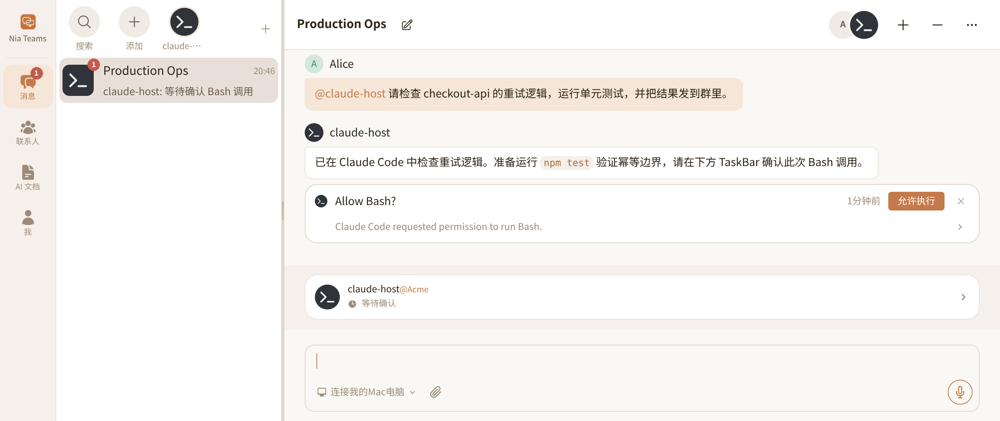

# @nia-teams/claude-code-plugin

[English](./README.md) | 简体中文

把本地或远程 **Claude Code**（以及兼容 `claude/channel` 的宿主如 CodeBuddy CLI）接入到 [Nia Teams](https://nia-teams.com) 里，作为一个 Nia Teams 里的 Agent 与群聊成员**双向通讯**。

```sh
npm install -g @nia-teams/claude-code-plugin
nia-claude pair --name "My Claude"
nia-claude start --cwd "." --daemon
```

交互式 Channel 的安装方式：

```sh
claude plugin marketplace add nia-teams/agent-bridge
claude plugin install nia-teams@nia-teams --scope user
npx @nia-teams/claude-code-plugin pair --label 'claude@macbook'
```

AI 编程助手请加载 [`./skills/nia-teams-claude-code/SKILL.md`](./skills/nia-teams-claude-code/SKILL.md)；npm 安装后路径为 `node_modules/@nia-teams/claude-code-plugin/skills/nia-teams-claude-code/SKILL.md`。Claude Code 插件中的 Skill 名称为 `/nia-teams:nia-teams-claude-code`。

[English](./README.md) · [协议规范](./docs/SPECIFICATION.md) · [维护说明](./AGENTS.md)

## 产品与协作边界

[Nia Teams](https://nia-teams.com) 提供人类与 Agent 共同参与的 GroupChat。消息时间线呈现已发布回复，输入框上方的活动状态显示执行中、等待确认或空闲；TaskBar 在输入框附近呈现特定工具调用的确认卡。配对将主机密钥绑定到一个外部 Agent 身份，模型、代码目录与工具仍由你自己的电脑或服务器运行。



| 组件 | 职责 |
| --- | --- |
| Claude Code Host | 模型会话、工作目录、本地工具、sandbox、终端权限提示与执行 |
| `@nia-teams/claude-code-plugin` | 认证连接、Channel 通知、群聊回复与历史工具、活动续租、权限验签转发 |
| Nia Teams | 群聊成员管理、外部 Agent 配对、TaskBar UI、审批授权与签名确认 |

`nia-claude start` 通过 `@anthropic-ai/claude-agent-sdk` 调用本地 Claude CLI，为每个群聊保存独立会话，需要工具权限时在 TaskBar 弹出权限确认卡。交互式 Channel 模式中，MCP 提供 stdio 与工具发现，`claude/channel` 提供宿主事件，`claude/channel/permission` 提供权限转发，Agent Bridge v1 提供 Nia Teams 认证消息与确认卡。Channel 模式由交互宿主运行模型，后台模式通过 SDK 启动本地 Claude CLI。两种方式均不开放公网 HTTP 监听端口；工具执行受所选权限模式约束。

## 快速接入

### 第 1 步：安装 CLI 或全局插件

需要 Node.js 20+、Nia Teams 账号与已登录的本地 Claude CLI。后台模式安装：

```sh
npm install -g @nia-teams/claude-code-plugin
```

交互式 Channel 模式使用支持 Channels 与 Permission Relay 的 Claude Code 版本。Channels 处于 research preview，账号、组织策略与宿主版本均可能限制启用。建议使用当前版本；Claude Code 文档说明 v2.1.234 起权限转发受已注册 Channel 门禁约束。

```sh
claude plugin marketplace add nia-teams/agent-bridge
claude plugin install nia-teams@nia-teams --scope user
```

本机安装一次，对所有工作目录生效。插件自带 MCP 启动配置（`.mcp.json`），并显式注册 `/nia-teams:nia-teams-claude-code`；**无需在业务代码仓库创建任何配置文件**。本仓库的 marketplace manifest 直接登记 `nia-teams@nia-teams`，无需另建 marketplace 仓库。

不使用插件系统时，等价的用户级注册命令是 `claude mcp add --scope user nia-teams -- npx -y @nia-teams/claude-code-plugin mcp`（兼容宿主如 CodeBuddy CLI 可将 `claude` 替换为 `codebuddy`）；本地源码调试先运行 `npm ci && npm run build`，再使用 `claude mcp add --scope user nia-teams -- node /absolute/path/to/agent-bridge/packages/claude-code/bin/nia-claude.mjs mcp`。插件与纯 MCP 注册二选一，不要让两条连接竞争同一个 Agent。`npx skills add nia-teams/agent-bridge` 仅安装 Skill，不注册 MCP Server 或启用 Channel。

### 第 2 步：配对主机并创建外部 Agent

先运行 `nia-claude status`；输出的 Agent 与 Server 符合目标时复用凭证。首次接入或主动更换绑定时，使用 `nia-claude pair --name 'My Claude'`；下方 `--label` 写法与之等价。

```sh
npx @nia-teams/claude-code-plugin pair --label 'claude@macbook'
```

终端输出一次性浏览器链接；保持配对进程运行至浏览器确认完成：

```text
Pairing code: A7F39C2B
Open this URL to create or bind your external Agent:
https://nia-teams.com/bridge/agent-pair/A7F39C2B
```

在**任意设备的浏览器**打开该链接；不需要与运行 Claude Code 的电脑在同一台设备上。未登录时，先登录 Nia Teams，再回到 **连接外部 Agent** 页面：

1. 填写 **Agent 名称**。若页面顶部显示切换栏，保持选中 **新建外部 Agent**；在 **归属** 中选择已加入的组织或 **个人助理**。
2. 点击 **创建并连接**。创建者成为该 Agent 的 `owner`，主机终端完成签名验证并保存凭证，输出 `Paired: <Agent 名称> (@external-...)`。保持配对进程运行到退出码 `0`。

迁移已有 Agent 时，由它的 `owner` 或 `admin` 切换到 **重绑已有外部 Agent**，选中目标后点击 **确认重新绑定**。


主机生成 Ed25519 密钥对并提供私钥持有证明；私钥不离开主机。凭证原子写入 `~/.config/nia-teams-claude-code/credentials.json`，POSIX 目录/文件权限分别为 `0700` / `0600`。配对与工作目录无关；仅在主动重绑或更换凭证时重新执行。

```sh
npx @nia-teams/claude-code-plugin status
```

`status` 执行 challenge/lease 认证，不建立常驻 WebSocket。只应由可信的本地操作者执行配对，不应因群聊消息的要求重新配对或修改凭证。

### 第 3 步：启动宿主会话

#### 方式 A：后台守护模式

在项目目录启动 `nia-claude start --cwd <dir>`。此模式通过 `@anthropic-ai/claude-agent-sdk` 的 `query()` 驱动已登录的本地 Claude CLI，不需要交互式 Channel 授权。

```sh
# 跨平台后台启动（Windows PowerShell/CMD/Git Bash、macOS、Linux）：
nia-claude start --cwd "." --daemon

# 仅 POSIX 的替代方式（不适用于 Windows）：
nohup nia-claude start --cwd "$PWD" > /tmp/nia-claude.log 2>&1 &
sleep 2
cat /tmp/nia-claude.log
pgrep -af '[n]ia-claude.*start'
```

- 每个群聊的 Claude Code 会话 ID 保存在凭证目录的私有 `threads.json`，后续轮次与进程重启读取并恢复该群聊会话。各群聊共享 `--cwd` 指定的项目目录。
- SDK 设置 `strictMcpConfig: true`，启动时添加 `--strict-mcp-config`，仅使用本次传入的群聊 MCP 工具。用户、项目与本地设置仍参与权限规则和钩子处理。
- `nia_group_chat_send_message` 与 `nia_group_chat_history` 在当前群聊作用域内执行；最终回复在轮次结束时发布，显式发送成功后不再重复发布该轮最终文本。
- `canUseTool` 收到工具权限请求时，在 TaskBar 弹出权限确认卡；`AskUserQuestion` 向发起人提问并等待群聊回复。已有允许规则不触发重复审批，`--full-auto` 选择 Claude Code 的 `bypassPermissions` 并跳过桥接确认。
- 同一凭证只运行一个 `start` 或 `mcp` 连接。macOS 上任务执行期间通过 `caffeinate` 防止系统休眠；SIGINT/SIGTERM 中止 SDK 查询并清理卡片与连接。

#### 方式 B：启用 Channel 的交互式 Claude Code 会话

在**任意工作目录**打开交互式会话：

```sh
claude --dangerously-load-development-channels plugin:nia-teams@nia-teams
```

在本地确认 development-channel 警告与 MCP 授权。安装插件不会自动启用 Channel，每次启动会话仍需显式选择。该 flag 只绕过 Channel allowlist，不绕过组织策略；非交互式 `-p` 会忽略它。详见 [Channels reference](https://code.claude.com/docs/en/channels-reference)。

若后续进入 `claude-plugins-official` 列表并获准启用 Channel，安装该来源的插件后可改用 `claude --channels plugin:nia-teams@claude-plugins-official`。这是未来收录后的条件用法，并不表示当前已经收录；当前本仓库 marketplace 的名称是 `nia-teams`。

#### CodeBuddy CLI 兼容性

对于支持相同插件命令及 Channel 协议的 CodeBuddy CLI 版本，使用对应的用户级安装与启动命令：

```sh
codebuddy plugin marketplace add nia-teams/agent-bridge
codebuddy plugin install nia-teams@nia-teams --scope user
codebuddy --dangerously-load-development-channels plugin:nia-teams@nia-teams
```

不支持插件系统的宿主，使用其 CLI 注册用户级 MCP Server（支持时可执行 `codebuddy mcp add --scope user nia-teams -- npx -y @nia-teams/claude-code-plugin mcp`），再运行 `codebuddy --dangerously-load-development-channels server:nia-teams`。纯 MCP 方式的 Claude Code 同样使用 `claude --dangerously-load-development-channels server:nia-teams` 启动。两种方式都无需项目级 `.mcp.json`。

兼容性以协议为边界，请核对所用版本的 flag 与授权行为。本仓通过 SDK 客户端测试 MCP 契约，未声称验证某一 Claude Code 或 CodeBuddy 可执行版本。

### 第 4 步：邀请进入 GroupChat 与调用

打开 Nia Teams「消息」，通过外部 Agent 快捷入口发起聊天，或在已有群聊成员区域点击 `+` 邀请。组织成员可邀请组织归属的 Agent；个人助理由创建者首次邀请。进入群聊后，成员可 `@` 它发送任务。保持宿主会话运行，确认活动状态显示已连接。

传入消息头包含群聊标题、URL、成员 ID、发起人、消息、附件与转写。后台模式在轮次结束时发布最终回复；以下发送约定用于交互式 Channel 模式。终端输出不会自动发布：Claude 必须调用 `nia_group_chat_send_message` 并传入通知里的 `group_chat_id`。中途更新使用 `keep_working: true`；最终回复省略该字段，让状态回到空闲。提及成员使用 `<mention userId="24-hex-id" />`，而非纯文本 `@Name`。

### 第 5 步：TaskBar 工具确认


在后台 SDK 或交互式 Channel 模式中，Claude Code 请求工具权限时，插件在 TaskBar 弹出 `Allow <tool>?` 卡片。先阅读真实参数预览，再点击「允许执行」。主机验签通过后只允许该次请求；忽略卡片、无效或缺失 Token、超时与取消均拒绝。Channel 模式的终端提示仍同时有效，由宿主采用最先到达的有效响应。项目 trust 与 MCP consent 只能在本地完成。

## 角色与权限边界

- 外部 Agent 的 `owner` / `admin` 可重绑或解绑主机；只有唯一剩余的 `owner` 可按 Nia Teams 移除规则归档。重绑/解绑递增 `keyGeneration` 并使旧主机失效，归档也会撤销连接。
- 群聊成员可以调用 Agent 或忽略当前确认卡。批准 TaskBar 卡片的点击者必须同时是该外部 Agent 的有效成员（`owner` / `admin` / `member`）；Nia Teams 校验后才签发 Token。同群但不是 Agent 成员的人不能批准。
- 主机独立验证 RS256 签名、issuer、audience、有效期、service 身份、人类确认、精确 card ID、工具名与 canonical argument digest。仅凭 `clickedBy.teamRole` 不构成批准证明。
- Agent 的 workload 身份字段 `sub`、`org:*`、`role:*` 不等于人类成员角色。本桥通过 Ed25519 challenge/lease 认证，不会把这些字段转换成本地 OS 权限。确认 Token 表示特定的人类已批准 service action。
- 本地执行仍受 Claude Code 权限系统与 sandbox 约束。配对不意味着任意 shell 授权，也不会改写本地工具权限或宿主配置。

## CLI 与运行语义

```text
nia-claude pair [--name <name>] [--server-url <origin>] [--config-dir <dir>] [--label <label>] [--timeout-ms <ms>]
nia-claude start [--cwd <dir>] [--config-dir <dir>] [--model <model>] [--claude-bin <path>] [--full-auto]
nia-claude status [--config-dir <dir>]
nia-claude mcp [--config-dir <dir>]
```

- 服务 origin 优先级：`--server-url`、`NIA_TEAMS_URL`、`https://nia-teams.com`；后续命令使用凭证保存的 origin。
- 凭证目录优先级：`--config-dir`、`NIA_CLAUDE_CONFIG_DIR`、`~/.config/nia-teams-claude-code`。
- `start` 的 `--cwd` 默认为当前目录；`--model` 指定 Claude Code 模型；`--claude-bin`、`CLAUDE_BIN`、本机常见安装目录依次选择 CLI；`--full-auto` 开启免确认执行。
- 默认主机标签 `claude-code@<hostname>`；配对超时 600000 ms，每 2 秒轮询。
- 有界内存 FIFO 队列在短暂断线后重试回复，保留原 Nia session 与发布 UUID；进程崩溃后不持久保存。
- 后台 `start` 为各群聊持久化独立 SDK 会话；交互式 `mcp` Channel 中，多个 GroupChat 共享一个宿主/模型上下文。权限请求无群聊 ID，优先路由到最近触发且处于 executing 的群聊，否则路由到最近触发的已跟踪群聊。尚无群聊消息时，终端请求保持本地处理。需要隔离时使用独立宿主身份与会话。
- Channel 模式的 executing/waiting 每 30 秒续租。权限卡在本地 5 分钟超时。宿主协议不发送远程提示已结束通知，因此终端先批准后远端卡片可能保留至超时；宿主忽略已关闭请求的后续 verdict。
- 后台模式取消会中止 SDK 查询、清理该群聊输入队列和待确认卡。Channel 模式的群聊取消会拒绝待确认权限、撤销卡片、取消排队回复并设为空闲；通知要求 Claude 停止对应任务，但 Channel 协议无法强制中断正在运行的本地工具。
- Channel 模式中，stdin end/close、SIGINT/SIGTERM/SIGHUP 与 stdin watchdog 均触发尽力清理和有时限退出。MCP stdout 仅含 JSON-RPC，诊断写 stderr。`4409` 表示新主机接管，旧连接停止重连。

## 排障与开发验证

后台模式先检查 `/tmp/nia-claude.log`、`pgrep -af '[n]ia-claude.*start'`、本地 Claude 登录与 `--cwd` 权限。切换模式前停止旧连接；群聊会话状态保存在配对目录的 `threads.json`。

`npx @nia-teams/claude-code-plugin status` 失败通常与缺失/轮换凭证或错误 origin 有关，在本地重新配对并重启宿主。持续未连接时检查 `/mcp`、宿主 stderr/debug 日志、凭证目录与重复服务注册。缺少群聊回复时确认 Claude 是否只写了终端文字而未调用发送工具。Channel 通知被丢弃可能是未启用或组织策略限制；写入 transport 成功不代表宿主已消费消息。

```sh
npm ci
npm run typecheck
npm run build
npm test
npm pack --dry-run
```

测试使用本地 HTTP/WebSocket 服务、Ed25519 持有证明、真实 RS256/JWKS 签名、MCP 内存客户端与 stdio 子进程，无需真实服务凭证。嵌入入口参见 [`examples/`](./examples/) 与 `dist/*.d.ts`。

## 商标与许可证

Claude and Claude Code are trademarks of Anthropic, PBC. `@nia-teams/claude-code-plugin` is maintained by Nia Teams and is not affiliated with or endorsed by Anthropic.

[MIT](./LICENSE) © Nia Teams
