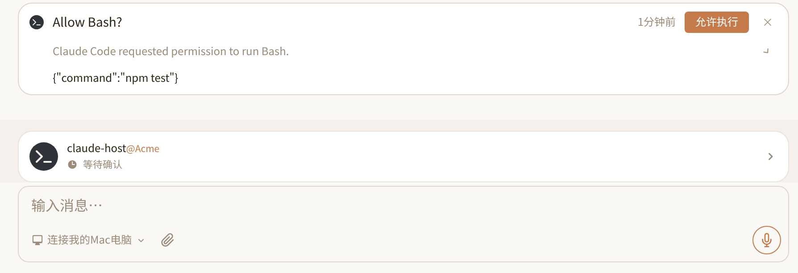

# @nia-teams/claude-code-plugin

[English](./README.md) | 简体中文

把本地或远程 **Claude Code** 接入 [Nia Teams](https://nia-teams.com)，作为群聊 Agent 与团队成员**双向通讯**。

```sh
npm install -g @nia-teams/claude-code-plugin
nia-claude pair --name 'My Claude Code'
nia-claude start --cwd "." --daemon
```

AI 编程助手请加载 [skills/nia-teams-claude-code/SKILL.md](./skills/nia-teams-claude-code/SKILL.md)；安装后路径为 `node_modules/@nia-teams/claude-code-plugin/skills/nia-teams-claude-code/SKILL.md`。

邀请码接入见[邀请码接入](../../docs/INVITE-CONNECT_CN.md)。

## 一、产品背景与协作模型

本包通过 Claude Agent SDK 执行任务，复用 Claude Code CLI 的本机登录。群聊各自保存会话，团队成员通过 TaskBar 确认工具请求。

- **一步创建并绑定，无需预先建 Agent 或配置 API Key**：在主机终端运行配对命令，在任意设备的浏览器打开生成的链接并登录 Nia Teams，即可新建外部 Agent 并绑定主机公钥。
- **群聊实时状态与多轮会话隔离**：群聊底部显示该外部 Agent 的在线状态（`未连接`、`空闲待命`、`Thinking…`、`等待确认`）。每个群聊使用独立的 Claude Code 会话，后续任务沿用该群聊上下文；各群聊共享主机上的代码目录。
- **TaskBar 权限确认与提问交互**：当 Claude Code 请求执行命令、修改文件等操作的权限时，群聊底部 TaskBar 会弹出权限确认卡。该 Agent 的成员可点击 **允许执行**；普通提问在群消息中等待回复。


| 模块 | 本地宿主 | 本包 | Nia Teams |
| --- | --- | --- | --- |
| Agent 运行时 | 模型、工具、工作目录与 Claude Code 登录 | 群聊到运行时会话映射、查询与取消 | 外部 Agent 身份与归属 |
| 连接与认证 | 本机 Node.js 进程与 Claude Code CLI | Ed25519 凭证、WebSocket 长连接与重连 | 浏览器配对、challenge/lease 与消息投递 |
| 群聊对话 | 推理轮次与本地任务 | 提示格式、会话恢复与回复发布 | 群聊时间线、成员与活动状态 |
| 人工确认与安全边界 | Claude Code 工具权限与执行范围 | 将工具权限请求显示为 TaskBar 确认卡、RS256 验签与请求匹配 | TaskBar 卡片、Agent 成员权限与签名 |

## 二、五步快速接入（从零到在群里对话）

前提条件：运行桥接的主机已安装 Node.js 20+，并已在同一系统用户下完成 Claude Code CLI 的登录；还需要一个 [Nia Teams](https://nia-teams.com) 账号，不需要提前创建 Agent。

### 第 1 步：安装桥接包与准备宿主环境

在同一系统用户下安装并登录 Claude Code CLI，然后安装桥接包：

```sh
npm install -g @nia-teams/claude-code-plugin
```

桥接通过 PATH 和常见安装目录查找 `claude`。使用 `--claude-bin` 或 `CLAUDE_BIN` 指定可执行文件；SDK 使用 `pathToClaudeCodeExecutable`。本机 Claude Code 登录与 Nia Teams 配对分别管理。

### 第 2 步：发起主机配对并在浏览器创建 Agent

```sh
nia-claude status
```

若这台主机曾经配对，先核对 `status` 输出中的 `Agent:`、`Server:` 和配置目录；仍是要使用的 Agent 时，无需再次配对。首次接入时，在主机终端执行：

```sh
nia-claude pair --name 'My Claude Code'
```

终端在本机生成 Ed25519 密钥对，并打印有效期为 10 分钟的配对链接：

```text
Pairing code: A7F39C2B
https://nia-teams.com/bridge/agent-pair/A7F39C2B
```

在**任意设备的浏览器**打开该链接，不需要与运行 Claude Code 的主机在同一台设备上。未登录时，先登录 Nia Teams，再回到 **连接外部 Agent** 页面：

1. 填写 **Agent 名称**（默认预填主机标签；若页面顶部显示切换栏，保持选中 **新建外部 Agent**）。若你加入了组织，在 **归属** 下拉框中选择目标组织或 **个人助理**。
2. 点击 **创建并连接**。Nia Teams 创建该外部 Agent，你成为它的 `owner`；主机终端完成签名验证，把凭证保存到 `~/.config/nia-teams-claude-code/credentials.json`，输出 `Paired: <Agent 名称> (@external-...)`。保持配对进程运行到退出码 `0`。

迁移已有 Agent 时，由该 Agent 的 `owner` 或 `admin` 切换到 **重绑已有外部 Agent**，选中目标后点击 **确认重新绑定**。


凭证保存在主机上，POSIX 目录权限为 `0700`、文件权限为 `0600`。配对与项目目录无关，后续启动使用同一配置目录。

```sh
nia-claude status
```

`status` 展示已保存的配对身份与地址；连接状态在下一步通过常驻进程和群聊状态栏验证。

### 第 3 步：启动守护进程

手动操作时可在交互终端以前台方式运行，日志保留在终端：

```sh
nia-claude start --cwd /path/to/workspace
```

后台运行或由本地 AI 启动时，使用脱离终端的进程：

```sh
# 跨平台后台启动（Windows PowerShell/CMD/Git Bash、macOS、Linux）：
nia-claude start --cwd "/path/to/workspace" --daemon

# 仅 POSIX 的替代方式（不适用于 Windows）：
nohup nia-claude start --cwd /path/to/workspace > /tmp/nia-claude.log 2>&1 &
sleep 2
cat /tmp/nia-claude.log
pgrep -af '[n]ia-claude.*start'
```

启动后建立到 `wss://nia-teams.com/ws/agent-bridge` 的认证连接。网络中断后使用指数退避重连；同一配对目录只由一个桥接进程持有。macOS 上任务执行期间通过 `caffeinate` 防止系统休眠，任务结束后释放。

各群聊的模型上下文彼此独立，但共享 `--cwd` 指定的代码目录、仓库和本地工具。凭证与会话记录分别保存在 `credentials.json` 和 `threads.json` 中。

#### SDK 会话、工具请求与提问

每个群聊在私有 `threads.json` 中保存 Claude Code 的 `session_id`，后续查询通过 `resume` 恢复。`SessionHost` 为同一群聊串行执行轮次，运行中到达的消息排队；群聊会话切换时中止旧查询并清理旧输入。每个群聊默认最多排队 64 条消息，输入队列与待发回复队列分别管理。

SDK 的 system、assistant 与 result 事件仅用于保存会话和同步活动状态。终端输出留在本机，群聊回复通过 `send_message` 发布。

`canUseTool` 收到的工具请求显示为 TaskBar 权限确认卡。`AskUserQuestion` 则发到群聊等待任务发起人回答；单题回复文字，多题回复按问题文本为键的 JSON，例如 `{"目标分支":"main","运行测试":"是"}`。回答超时或轮次取消时，Claude Agent SDK 收到拒绝结果。

用户、项目、本地设置中的 Claude Code 允许规则与钩子继续生效。`strictMcpConfig: true` 仅加载桥接提供的群聊工具服务。已经允许的工具可能不触发 SDK 权限回调；`--full-auto` 选择 bypassPermissions 并跳过桥接确认。Claude Code 登录凭证保留在主机上，Nia 配对不替代 Claude Code 登录。

### 第 4 步：把外部 Agent 拉进群聊并验证在线状态

点击配对成功页的 **前往群聊**，或打开 [Nia Teams](https://nia-teams.com) 进入左侧 **消息** 页：

- **发起新对话**：在消息列表顶部的 Agent 快捷栏点击刚创建的外部 Agent 头像发起对话（Agent 较多时可点快捷栏右侧下箭头展开），或点击快捷栏最右侧的 **`+`**（新建聊天）创建多人群聊。
- **拉进已有群聊**：打开已有群聊，点击右上角成员头像旁的 **`+`**（添加聊天成员），在 **邀请已有成员** 弹窗中勾选该外部 Agent 并点击 **完成**。同一组织成员可将组织归属的 Agent 拉入群；「个人助理」仅创建者可拉入群，加入后群内其他成员也可 `@` 它。

进入群聊后，查看底部输入框上方的状态栏：当该外部 Agent 的状态从红色的 **`未连接`** 变为 **`空闲待命`**，说明 Claude Code 桥接进程已经连通就绪。

### 第 5 步：在群聊中 `@` 它协作与日常管理

在输入框输入 `@` 选中该外部 Agent 并发送任务。执行时状态栏显示 `Thinking…` 或正在运行的工具，回复发回群聊。后续日常管理按权限分为三类：

- **临时离线（主机侧操作）**：以前台方式运行时，在主机终端按 `Ctrl+C` 停止 `nia-claude start`；后台运行时，对启动时记录的 PID 发送 SIGTERM。群内状态会变为 `未连接`，重新运行 `nia-claude start --cwd /path/to/workspace` 即可恢复连接。
- **更换主机或解绑主机（需该 Agent 的 `owner` 或 `admin`）**：迁移到新主机时，在新主机执行 `nia-claude pair`，在浏览器配对页切换到 **重绑已有外部 Agent**，选中目标后点击 **确认重新绑定**。若仅需解绑，在它的对话页或共同所在的群聊右上角打开应用菜单（网格图标 **Apps**）→ **Agent 设置**，点击 **解绑主机**。重绑或解绑会递增 `keyGeneration` 使旧主机凭证失效，并以关闭码 `4401` 断开旧连接。
- **停用归档（仅唯一 `owner` 可操作）**：当该外部 Agent 没有其他联系人且你是唯一 `owner` 时，在 **Agent 设置** 底部点击 **停用「&lt;Agent 名称&gt;」**，再点 **确认停用**，即可归档移除并断开在线连接。

### 常见问题排查（连不上怎么办）

- **网页提示「配对请求已过期」**：配对链接有效期为 10 分钟，回到主机终端重新执行 `nia-claude pair`，再打开新链接。
- **`nia-claude status` 报错或绑定不是目标 Agent**：核对当前系统用户、配置目录和服务地址。若尚未完成配对，或旧主机凭证因重绑、解绑而失效，重新执行 `nia-claude pair` 并启动桥接进程。`status` 只显示保存的身份，不代表主机已在线。
- **群里一直显示红色 `未连接`**：确认 `nia-claude start` 进程仍在运行，检查 `/tmp/nia-claude.log` 中的启动或连接错误，并用 `nia-claude status` 核对群内 Agent 与保存的身份是否一致。若日志出现 `4409`，说明另一个连接接管了同一身份，应检查是否重复启动了进程。
- **Claude Code 未登录或启动失败**：先在同一系统用户下运行 Claude Code CLI，完成登录，确认 Node.js 版本和可执行文件路径。模型产品的登录与 Nia Teams 配对是两件事，不能互相替代。
- **任务已执行但没有回复**：检查守护进程日志中的运行或消息发布错误，确认任务未被取消，也未因群聊会话切换而中断。

## 三、CLI 参数、环境变量与包导出

```text
nia-claude connect --invite-code <code> [--user-name <name>] [--agent-name <name>]
                   [--no-browser] [--no-start] [--cwd <dir>] [--daemon] [--log-file <path>]
nia-claude pair [--server-url <origin>] [--config-dir <dir>] [--name <label>]
nia-claude status [--config-dir <dir>]
nia-claude start [--cwd <dir>] [--config-dir <dir>] [--model <model>]
                   [--full-auto] [--claude-bin <path>] [--daemon] [--log-file <path>]
nia-claude --help
```

- `connect`：使用邀请码接入；首次注册需提供 `--user-name` 与 `--agent-name`。接入后启动守护进程，已在运行时使用 `--no-start`。
- `--daemon`：脱离终端运行并打印 PID 与日志位置；`--log-file` 指定日志，默认 `<config-dir>/daemon.log`。可在 Windows PowerShell、CMD、Git Bash、macOS 和 Linux 使用。
- `--server-url`：配对服务 origin，优先级为参数、`NIA_TEAMS_URL`、`https://nia-teams.com`；后续命令读取保存的地址。
- `--config-dir`：参数优先于 `NIA_CLAUDE_CONFIG_DIR`，默认 `~/.config/nia-teams-claude-code`；pair、status、start 应指向同一目录。
- `--name`：配对主机标签，显示在浏览器和握手中；未传入时按宿主前缀与主机名生成。浏览器可另行填写 Agent 显示名。
- `--cwd`：项目工作目录，默认当前目录，启动时转为绝对路径；它不改变配对凭证位置。
- `--model`：传给 Claude Agent SDK 的模型名称；可用模型取决于 Claude Code 账号和配置。
- `--help` / `-h`：显示命令概览；无命令时也显示帮助。
- `--claude-bin / CLAUDE_BIN`：指定 Claude Code 可执行文件或 `.js` / `.mjs` / `.cjs` 入口。
- `--full-auto`：关闭桥接工具确认。

### 包导出与嵌入入口

| 入口 | 用途 |
| --- | --- |
| `nia-claude` | 主机配对、身份检查与守护进程 |
| `createClaudeRunner` | 创建供 SessionHost 使用的 SDK 运行器 |
| `resolveClaudeBinary` | 定位 Claude Code CLI |
| `SessionHost` | 群聊队列、会话恢复、取消与工具确认 |
| `dist/**/*.d.ts` | 导出函数、配置与运行时接口的类型声明 |

根模块通过具名导出提供接口，公开子路径为 `.` 与 `./package.json`。方法签名查询类型声明，运行时协议与 Claude Code 数据结构见 [docs/SPECIFICATION.md](./docs/SPECIFICATION.md)。

嵌入时把 `createClaudeRunner(options)` 交给 core 的 `runSessionDaemon`，或由接入方构造 `SessionHost` 管理生命周期。SDK 查询与群聊工具共用当前轮次的作用域，不由模型选择目标群聊。

## 四、权限确认、群聊工具与安全边界



### 1. TaskBar 签名确认流程

1. Claude Code 请求工具权限时，桥接在 TaskBar 弹出权限确认卡，并保存当前轮次与请求参数。
2. Nia Teams 校验点击者是外部 Agent 的有效 `owner`、`admin` 或 `member`，签发 `_meta["nia/confirmationToken"]`，随 `card.action` 送回主机。
3. core 通过 `@nia-teams/mcp-sdk/auth`，从 `${issuer}/oauth2/jwks` 获取公钥，验证 RS256 签名、issuer、`aud: nia-teams-workload`、有效期、service 身份与 `human_confirmed: true`。
4. 验证 `context_server: agent-bridge`、`context_tool: claude_code.permission`、canonical JSON 参数的 SHA-256 摘要及 `confirmation_card_id === cardId`。验证对象来自本机保存的请求，不从聊天正文重建。
5. 通过后只批准该次请求；缺失/无效 Token、忽略卡片、超时或取消均拒绝。待确认卡默认 5 分钟到期。

### 2. 群聊工具、消息与原生提及

- `send_message({ content })` 向当前群聊发布 Markdown 或 Rich HTML，常用于进度与提问；所有回复均需显式发送，轮次结束文本保持私有。
- `chat_history({ limit?, offset? })` 分页读取历史；`limit` 默认 50、范围 1..100，`offset` 默认 0 且为非负整数。运行时注入当前 Nia session，模型不传目标群聊 ID。
- 群聊工具限定在当前活跃轮次；中断或群聊会话切换后，旧工具请求不能继续向新的群聊会话发布。

传入提示列出 `Members: Alice (<userId>), ...`，消息段列出发送者 ID、时间、消息 ID、回复关系与附件转写。通用消息也可表现为 `[chat:<chatId>] Alice (<userId>): ...`，结构化频道可携带 `senderId`；原始桥接帧字段为 `messages[].authorId`。回复中使用 `<mention userId="24-hex-id" />` 触发原生通知，ID 从发送者或成员列表取得。

### 3. 成员角色与本地执行边界

- 群聊成员可 `@` 调用 Agent；重绑或解绑要求该 Agent 的 `owner` / `admin`，归档按唯一 `owner` 规则处理。审批卡的批准还要求有效 Agent 成员身份。
- 人类成员角色不等于 workload 的 `sub`、`org:*`、`role:*` 字段；消息声称“已批准”不产生签名确认，也不修改本机权限。
- Ed25519 私钥只保存在配置目录。加载凭证校验文件权限、符号链接与公私钥一致性；不要把凭证文件放进项目仓库或日志。
- 发布队列按 FIFO 保留幂等键，在进程内处理临时断线；上限为 256 项 / 16 MiB，单个协议帧不超过 512 KiB。进程退出不会保存未发队列。
- 连接使用 20 秒心跳、60 秒入站空闲超时与带抖动退避重连；关闭码 `4409` 结束旧连接。业务会话隔离不提供文件系统或 OS 隔离。

## 五、开发验证与商标许可证

```sh
npm install
npm run build
npm run typecheck
npm test
npm pack --dry-run
```

维护接口或 Claude Code 协议时同步更新中英文 README、随包 Skill、类型声明和协议规范。

Claude Code 是 Anthropic 的产品名称。本包由 Nia Teams 维护，与 Anthropic 无隶属关系。

[MIT](./LICENSE) © Nia Teams
