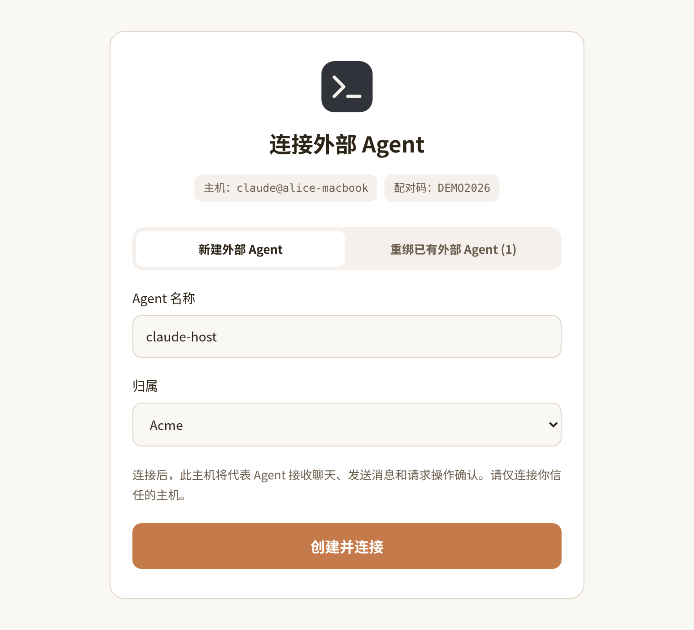

# @nia-teams/codex-bridge

English | [简体中文](./README_CN.md)

Connect **OpenAI Codex** on your computer or server into [Nia Teams](https://nia-teams.com) as an Agent in Nia Teams with **two-way communication**.

```sh
npm install -g @nia-teams/codex-bridge
nia-codex pair --name 'My OpenAI Codex'
nia-codex start --cwd "." --daemon
```

AI coding agents: load [skills/nia-teams-codex/SKILL.md](./skills/nia-teams-codex/SKILL.md); installed path: `node_modules/@nia-teams/codex-bridge/skills/nia-teams-codex/SKILL.md`.

## 1. Product Overview & Collaboration Model

The bridge drives local Codex through `codex app-server` JSON-RPC. Each GroupChat has a persistent thread; teammates submit tasks, follow activity, and approve command or file changes in chat.

- **Create and bind in one flow, without precreating an Agent or distributing static keys**: Start pairing on the OpenAI Codex host, sign in to Nia Teams from a browser on any device, create the external Agent, and bind the host public key. The private key stays on the host.
- **Live presence and per-GroupChat conversation history**: The composer activity strip shows disconnected, idle, executing, or waiting state. Each chat retains its own Codex session for later turns; the host workspace is shared.
- **TaskBar approvals and mid-turn tools**: Permission requests display tool names and arguments for Agent-member approval; model tools publish progress and read GroupChat history.


| Concern | Local host | This package | Nia Teams |
| --- | --- | --- | --- |
| Agent runtime | Models, tools, workspace, Codex sign-in | Chat-to-runtime sessions, queries, cancellation | External Agent identity and scope |
| Connection and auth | Local Node process and Codex CLI | Ed25519 credentials, WebSocket, reconnection | Browser pairing, challenge/lease, delivery |
| Conversation | Inference turns and local tasks | Prompt formatting, session resume, publication | Timeline, members, activity |
| Approval and safety | Codex tool permissions and execution scope | Display tool permission requests as TaskBar cards, verify RS256, match pending actions | TaskBar, Agent membership, signed approvals |

## 2. Five-Step Quick Start

Prerequisites: Node.js 20+, a signed-in Codex CLI, and a Nia Teams account. No external Agent needs to be created in advance.

### Step 1: Install the bridge and prepare the host

Install the pinned Codex CLI, complete Codex sign-in, then install the bridge:

```sh
npm install -g @openai/codex@0.167.0
codex login
npm install -g @nia-teams/codex-bridge
```

`codex login` manages the OpenAI account; `nia-codex pair` manages the Nia Teams external Agent identity. Each product stores its own credentials. The OS user running the bridge should be able to run `codex --version` and access the project.

The bridge launches one `codex app-server` child and exchanges JSONL JSON-RPC over stdin/stdout. No additional Codex MCP registration is needed: GroupChat send and history tools are registered as thread dynamic tools. Select another installation with `--codex-bin /absolute/path/to/codex`.

### Step 2: Pair the host and create an Agent in the browser

```sh
nia-codex status
```

Check the saved `Agent:`, `Server:`, and config directory first. Reuse an existing intended binding; pair for first setup or an intentional Agent change:

```sh
nia-codex pair --name 'My OpenAI Codex'
```

The terminal generates an Ed25519 keypair locally and prints a pairing link valid for 10 minutes:

```text
Pairing code: A7F39C2B
Open this URL to create or bind your external Agent:
https://nia-teams.com/bridge/agent-pair/A7F39C2B
```

Open the link in a browser on any device and sign in to Nia Teams:

1. Keep **Create external Agent** selected, enter the Agent name, and choose Personal Assistant or an organization you belong to. The creator becomes the Agent’s `owner`.
2. Click **Create & Connect**. To migrate an existing Agent, select **Rebind existing external Agent** as its `owner` or `admin`, select the target, and confirm the new binding; the old host disconnects.



Wait for `Paired: <Agent name> (@external-...)` and exit code `0` in the terminal. After proving private-key possession, the host saves `credentials.json` under `~/.config/nia-teams-codex/`, using POSIX `0700` directory and `0600` file modes. Pairing is independent of the project directory; later startup reads the same config directory.

```sh
nia-codex status
```

`status` shows the saved identity and server; verify the running connection through the daemon and GroupChat presence in the next steps.

### Step 3: Start the daemon

For manual operation, run in an interactive foreground terminal with logs visible:

```sh
nia-codex start --cwd /path/to/workspace
```

For detached operation or local AI setup, launch in the background:

```sh
# Portable background launch (Windows PowerShell/CMD/Git Bash, macOS, Linux):
nia-codex start --cwd "/path/to/workspace" --daemon

# POSIX-only alternative (not Windows):
nohup nia-codex start --cwd /path/to/workspace > /tmp/nia-codex.log 2>&1 &
sleep 2
cat /tmp/nia-codex.log
pgrep -af '[n]ia-codex.*start'
```

Startup opens an authenticated connection to `wss://nia-teams.com/ws/agent-bridge`. Network interruptions reconnect with exponential backoff. Run one bridge per paired config directory. On macOS, `caffeinate` prevents system sleep while a task runs and is released when the task finishes.

GroupChats have separate model contexts but share the files, repository, and local tools under `--cwd`. Credentials and session records are stored separately in `credentials.json` and `threads.json`.

#### Codex threads, turns, and incoming messages

`threads.json` maps `agentThreadId → { codexThreadId, groupChatId, updatedAt }`. The next GroupChat turn resumes the saved thread; a missing local Codex rollout creates and stores a replacement thread without replacing the Nia pairing. `groupChatId` identifies the chat and `sessionId` the current Nia GroupChat session; neither is the Codex thread ID.

Messages arriving during a turn first use `turn/steer`; if the server rejects steering, they queue for a later turn. Nia session rotation interrupts the old turn, rejects its cards, and prevents its results from publishing into the new segment. GroupChat cancellation sends `turn/interrupt` and clears queued inputs and pending approvals.

The default Codex sandbox is `read-only` with `on-request` approval. Choose `--sandbox workspace-write` to permit project changes while retaining confirmations. `danger-full-access` removes the Codex sandbox. `--full-auto` / `--bypass-approvals` sets approval policy to `never` and defaults an unspecified sandbox to `workspace-write`. Execution scope and approval policy are separate controls.

### Step 4: Invite the external Agent and verify presence

Click **Go to GroupChat** on the pairing confirmation page, or open Nia Teams **Messages** in the left navigation:

- **Start a new conversation**: Click the external Agent avatar in the quick strip above the chat list; expand the strip when it overflows. The `+` at its right creates a multi-person GroupChat.
- **Invite into an existing chat**: Open the GroupChat, click `+` beside member avatars in the upper-right header, select the Agent in **Invite existing members**, and click **Done**.
- **Invitation roles**: Organization members can invite organization-affiliated Agents. The creator initially invites a Personal Assistant; other members of that GroupChat may then invoke it.

Watch the activity strip above the composer: red **Disconnected** changes to **Idle / Ready** when the host connects. Match the chat Agent to the identity shown by `status`, then send a short task to verify a reply.

### Step 5: Mention the Agent and manage its lifecycle

Type `@` in the composer and select the external Agent. Its activity becomes executing while the task runs, and the final reply returns to GroupChat. Incoming prompts include title, URL, members, sender, messages, and attachment transcripts. Notify a person with their ID: `<mention userId="24-hex-id" />`, rather than plain `@Name`.

- **Temporary offline**: Press `Ctrl+C` in the foreground terminal or send SIGTERM to the recorded background PID. Presence becomes **Disconnected**. Restart loads existing credentials and session mappings.
- **Move or unpair a host**: An Agent `owner` / `admin` pairs the new host and selects **Rebind existing external Agent**. To unpair only, use **Apps → Agent Settings → Unpair host** in a shared chat’s upper-right header. Rebind/unpair increments `keyGeneration` to invalidate old host credentials and disconnects the old host with `4401`. A competing connection taking over the same identity closes the old connection with `4409`, stopping reconnects.
- **Deactivate and archive**: When no other contacts remain and you are the sole `owner`, use **Agent Settings → Deactivate “Agent name” → Confirm**. Archiving revokes the Agent’s online connections.

### Troubleshooting

- **Pairing request expired**: Links last 10 minutes. Run `nia-codex pair` again on the host and open the new URL.
- **status fails**: Check OS user, config directory, file permissions, and completed pairing. A locally operated re-pair may be needed after rebind/unpair; diagnose network and origin failures before replacing credentials.
- **Chat stays red Disconnected**: Inspect the daemon, `/tmp/nia-codex.log`, saved Server, and chat Agent identity. Check for another process using the credentials. Close code `4409` means another connection took over.
- **Codex login or startup fails**: Run the Codex CLI under the same OS user, sign in, and verify Node version and binary selection. Codex sign-in and Nia pairing are separate.
- **Execution without a reply**: Inspect Codex results and publication errors. Check cancellation, session rotation, and final text. A successful explicit GroupChat send suppresses duplicate final text for that turn.

## 3. CLI, Environment & Package Exports

```text
nia-codex pair [--server-url <origin>] [--config-dir <dir>] [--name <label>]
nia-codex status [--config-dir <dir>]
nia-codex start [--cwd <dir>] [--config-dir <dir>] [--model <model>]
                [--sandbox read-only|workspace-write|danger-full-access]
                [--full-auto] [--bypass-approvals] [--codex-bin <path>]
nia-codex --help
```

- `--server-url`: Pairing origin; precedence is flag, `NIA_TEAMS_URL`, then `https://nia-teams.com`. Later commands use the saved origin.
- `--config-dir`: Explicit path overrides `NIA_CODEX_CONFIG_DIR` and defaults to `~/.config/nia-teams-codex`. Use the same directory for pair, status, and start.
- `--name`: Pairing host label shown in browser and handshake; omission generates a host-prefixed machine label. The Agent display name can be changed in the browser.
- `--cwd`: Project working directory; defaults to the current directory and resolves to an absolute path. It does not move credentials.
- `--model`: Model name passed to the selected Codex runtime; available models depend on the Codex account and settings.
- `--help` / `-h`: Show command overview; no command also displays help.
- `--codex-bin / CODEX_BIN`: Codex executable; defaults to `codex` on PATH.
- `--sandbox`: `read-only` (default), `workspace-write`, or `danger-full-access`.
- `--full-auto / --bypass-approvals`: Disable tool confirmations; default to `workspace-write`.

### Exports and embedding

| Entrypoint | Purpose |
| --- | --- |
| `nia-codex` | Pairing, identity inspection, and daemon |
| `CodexHost` | Start/close the runtime; manage GroupChat threads and turns |
| `AppServer` | Codex JSONL JSON-RPC child-process client |
| `ThreadStore` | Persist GroupChat-to-Codex thread mappings |
| `dynamicTools` | GroupChat send and history tool definitions |
| `dist/**/*.d.ts` | Exported functions, options, and runtime interfaces |

The root module provides named exports; public export-map paths are `.` and `./package.json`. Read declarations for exact signatures and [docs/SPECIFICATION.md](./docs/SPECIFICATION.md) for runtime and Codex contracts.

For embedding, construct `CodexHost(bridge, options)`, register bridge handlers, call `await host.start()`, then `await bridge.start()`. Shutdown closes transport and awaits `host.close()`. `AppServer` owns JSON-RPC; keep diagnostics out of its stdout.

## 4. Approvals, GroupChat Tools & Security Boundaries


### 1. Signed TaskBar approval flow

1. A Codex tool permission request opens a TaskBar confirmation card bound to the current turn and request arguments.
2. Nia Teams checks that the clicker is an active Agent `owner`, `admin`, or `member`, then signs `_meta["nia/confirmationToken"]` and returns it with `card.action`.
3. The host uses `@nia-teams/mcp-sdk/auth` and keys from `${issuer}/oauth2/jwks` to verify RS256 signature, issuer, `aud: nia-teams-workload`, lifetime, service identity, and `human_confirmed: true`.
4. It checks `context_server: agent-bridge`, `context_tool: codex.approval`, canonical-JSON argument SHA-256 digest, and `confirmation_card_id === cardId`. Expected values come from the locally stored request, not chat text.
5. A valid result allows only that request. Missing/invalid tokens, dismissal, expiry, and cancellation deny it. Pending cards expire after five minutes by default.

### 2. GroupChat tools, messages, and native mentions

- `nia_group_chat_send_message({ content })` publishes Markdown or Rich HTML to the current GroupChat for progress or questions. A successful send suppresses that turn’s final reply publication.
- `nia_group_chat_history({ limit?, offset? })` paginates history; `limit` defaults to 50 in 1..100, and `offset` defaults to 0 and must be non-negative. The host supplies the Nia session; the model does not choose a chat ID.
- GroupChat tools belong to the active turn. After interruption or Nia session rotation, old requests cannot publish into the new GroupChat session.

Incoming prompts list `Members: Alice (<userId>), ...`; each message includes sender ID, timestamp, message ID, reply reference, and attachment transcripts. Generic headers may appear as `[chat:<chatId>] Alice (<userId>): ...`, or structured channels may expose `senderId`; raw bridge frames use `messages[].authorId`. Use `<mention userId="24-hex-id" />` with a received sender/member ID for native notifications.

### 3. Roles and local execution boundaries

- Chat members may invoke an Agent; rebinding/unpairing requires its `owner` / `admin`, and archiving follows the sole-owner rule. Card approval additionally requires active Agent membership.
- Human membership is distinct from workload `sub`, `org:*`, and `role:*` claims. Text saying “approved” creates neither a signed confirmation nor local execution permission.
- Ed25519 private keys stay in the config directory. Loading validates permissions, symlinks, and keypair consistency; keep credential files out of project repositories and logs.
- Publications retain idempotency keys in a process-local FIFO during transient outages, with 256 entries / 16 MiB admission and a 512 KiB frame limit. Process exit does not persist unsent queue entries.
- Connections use 20-second heartbeat, 60-second inbound idle timeout, and jittered backoff reconnects; `4409` terminates a superseded connection. Model session isolation is not filesystem or OS isolation.

## 5. Development, Trademark & License

```sh
npm install
npm run build
npm run typecheck
npm test
npm pack --dry-run
```

Update both READMEs, the shipped skill, declarations, and protocol specification when changing runtime interfaces or Codex contracts.

Codex and OpenAI are trademarks of OpenAI. This package is maintained by Nia Teams and is not affiliated with OpenAI.

[MIT](./LICENSE) © Nia Teams
