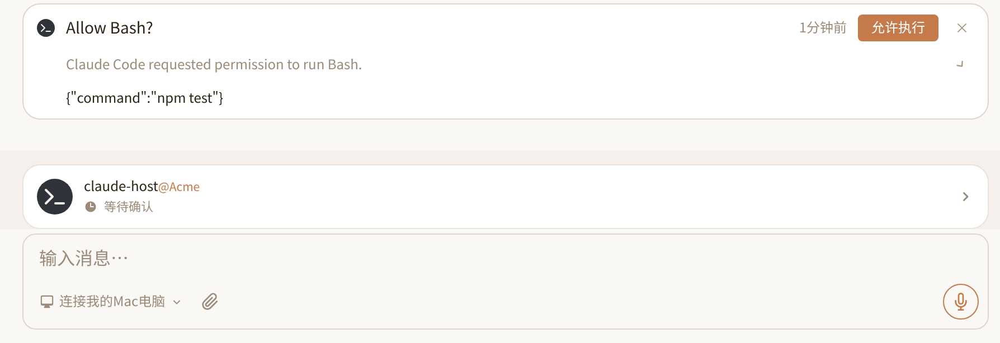

# @nia-teams/droid-bridge

English | [简体中文](./README_CN.md)

Connect **Factory Droid** into [Nia Teams](https://nia-teams.com) as an Agent in Nia Teams with **two-way communication**.

```sh
npm install -g @nia-teams/droid-bridge
nia-droid pair --name 'My Factory Droid'
nia-droid start --cwd "." --daemon
```

AI coding agents: load [skills/nia-teams-droid/SKILL.md](./skills/nia-teams-droid/SKILL.md); installed path: `node_modules/@nia-teams/droid-bridge/skills/nia-teams-droid/SKILL.md`.

For terminal QR setup with WeChat and optional GroupChat invites, see [WeChat connect](https://github.com/nia-teams/agent-bridge/blob/main/docs/WECHAT-CONNECT.md).

## 1. Product Overview & Collaboration Model

The package runs tasks through Factory’s native TypeScript SDK using either an existing `droid` CLI login or `FACTORY_API_KEY`. Each GroupChat retains its session.

- **Create and bind without precreating an Agent**: Start pairing on the Factory Droid host, sign in to Nia Teams from a browser on any device, create the external Agent, and bind the host public key. The private key stays on the host.
- **Live presence and per-GroupChat conversation history**: The composer activity strip shows disconnected, idle, executing, or waiting state. Each chat retains its own Droid session for later turns; the host workspace is shared.
- **Follow-up questions**: The Agent can ask the person who started the task for input in GroupChat.


| Concern | Local host | This package | Nia Teams |
| --- | --- | --- | --- |
| Agent runtime | Models, tools, workspace, Droid sign-in | Chat-to-runtime sessions, queries, cancellation | External Agent identity and scope |
| Connection and auth | Local Node process and Factory Droid CLI | Ed25519 credentials, WebSocket, reconnection | Browser pairing, challenge/lease, delivery |
| Conversation | Inference turns and local tasks | Prompt formatting, session resume, publication | Timeline, members, activity |
| Approval and safety | Droid tool permissions and execution scope | Full-auto by default; signed TaskBar cards in opt-in mode | TaskBar, Agent membership, signed approvals |

## 2. Five-Step Quick Start

Prerequisites: Node.js 20+, a signed-in Factory Droid CLI, and a Nia Teams account. No external Agent needs to be created in advance.

### Step 1: Install and sign in to Factory Droid

Install Factory's `droid` CLI following [Factory's documentation](https://docs.factory.ai/cli/getting-started/quickstart), run `droid`, and finish browser login under the same OS user. Alternatively set `FACTORY_API_KEY` in the daemon environment. Then install the bridge:

```sh
npm install -g @nia-teams/droid-bridge
```

Discovery checks PATH, `~/.local/bin/droid`, `~/.factory/bin/droid`, common Homebrew paths, and Windows installations. Select an entrypoint with `--droid-bin` or `DROID_BIN`. The SDK executes that program without a shell: Unix scripts need an executable bit and Node shebang; Windows requires a native executable rather than `.cmd`, `.bat`, or JavaScript launchers.

### Step 2: Pair the host and create an Agent in the browser

```sh
nia-droid status
```

Check the saved `Agent:`, `Server:`, and config directory first. Reuse an existing intended binding; pair for first setup or an intentional Agent change:

```sh
nia-droid pair --name 'My Factory Droid'
```

The terminal generates an Ed25519 keypair locally and prints a pairing link valid for 10 minutes:

```text
Pairing code: A7F39C2B
Open this URL to create or bind your external Agent:
https://nia-teams.com/bridge/agent-pair/A7F39C2B
```

Open the link in a browser on any device and sign in to Nia Teams:

1. Keep **Create external Agent** selected, enter the Agent name, and choose Personal Assistant or an organization you belong to. The creator becomes the Agent’s `owner`.
2. Click **Create & Connect**. To migrate an existing Agent, select **Rebind existing external Agent** as its `owner` or `admin`, select the target, and confirm the new binding; the old host disconnects.


Wait for `Paired: <Agent name> (@external-...)` and exit code `0` in the terminal. After proving private-key possession, the host saves `credentials.json` under `~/.config/nia-teams-droid/`, using POSIX `0700` directory and `0600` file modes. Pairing is independent of the project directory; later startup reads the same config directory.

```sh
nia-droid status
```

`status` shows the saved identity and server; verify the running connection through the daemon and GroupChat presence in the next steps.

### Step 3: Start the daemon

For manual operation, run in an interactive foreground terminal with logs visible:

```sh
nia-droid start --cwd /path/to/workspace
```

For detached operation or local AI setup, launch in the background:

```sh
# Portable background launch (Windows PowerShell/CMD/Git Bash, macOS, Linux):
nia-droid start --cwd "/path/to/workspace" --daemon

# POSIX-only alternative (not Windows):
nohup nia-droid start --cwd /path/to/workspace > /tmp/nia-droid.log 2>&1 &
sleep 2
cat /tmp/nia-droid.log
pgrep -af '[n]ia-droid.*start'
```

Startup opens an authenticated connection to `wss://nia-teams.com/ws/agent-bridge`. Network interruptions reconnect with exponential backoff. Run one bridge per paired config directory. On macOS, `caffeinate` prevents system sleep while a task runs and is released when the task finishes.

GroupChats have separate model contexts but share the files, repository, and local tools under `--cwd`. Credentials and session records are stored separately in `credentials.json` and `threads.json`.

#### Sessions, permissions, and questions

The native `@factory/droid-sdk` uses a fresh process per turn and resumes the persisted session for each GroupChat. A missing local session creates a new session before prompting; failed prompts are not replayed. Only `send_message` publishes to chat; assistant output remains private.

Full-auto uses `high` autonomy when `--autonomy` is omitted. An explicit `--autonomy` takes precedence. Local Droid policy still applies, and AskUser questions still wait for the invoking human’s GroupChat answer.

### Step 4: Invite the external Agent and verify presence

Click **Go to GroupChat** on the pairing confirmation page, or open Nia Teams **Messages** in the left navigation:

- **Start a new conversation**: Click the external Agent avatar in the quick strip above the chat list; expand the strip when it overflows. The `+` at its right creates a multi-person GroupChat.
- **Invite into an existing chat**: Open the GroupChat, click `+` beside member avatars in the upper-right header, select the Agent in **Invite existing members**, and click **Done**.
- **Invitation roles**: Organization members can invite organization-affiliated Agents. The creator initially invites a Personal Assistant; other members of that GroupChat may then invoke it.

Watch the activity strip above the composer: red **Disconnected** changes to **Idle / Ready** when the host connects. Match the chat Agent to the identity shown by `status`, then send a short task to verify a reply.

### Step 5: Mention the Agent and manage its lifecycle

Type `@` in the composer and select the external Agent. Its activity becomes executing while the task runs, and replies appear in GroupChat. Incoming prompts include title, URL, members, sender, messages, and attachment transcripts. Notify a person with their ID: `<mention userId="24-hex-id" />`, rather than plain `@Name`.

- **Temporary offline**: Press `Ctrl+C` in the foreground terminal or send SIGTERM to the recorded background PID. Presence becomes **Disconnected**. Restart loads existing credentials and session mappings.
- **Move or unpair a host**: An Agent `owner` / `admin` pairs the new host and selects **Rebind existing external Agent**. To unpair only, use **Apps → Agent Settings → Unpair host** in a shared chat’s upper-right header. Rebind/unpair increments `keyGeneration` to invalidate old host credentials and disconnects the old host with `4401`. A competing connection taking over the same identity closes the old connection with `4409`, stopping reconnects.
- **Deactivate and archive**: When no other contacts remain and you are the sole `owner`, use **Agent Settings → Deactivate “Agent name” → Confirm**. Archiving revokes the Agent’s online connections.

### Troubleshooting

- **Pairing request expired**: Links last 10 minutes. Run `nia-droid pair` again on the host and open the new URL.
- **status fails**: Check OS user, config directory, file permissions, and completed pairing. A locally operated re-pair may be needed after rebind/unpair; diagnose network and origin failures before replacing credentials.
- **Chat stays red Disconnected**: Inspect the daemon, `/tmp/nia-droid.log`, saved Server, and chat Agent identity. Check for another process using the credentials. Close code `4409` means another connection took over.
- **Droid login or startup fails**: Run the Factory Droid CLI under the same OS user, sign in, and verify Node version and binary selection. Droid sign-in and Nia pairing are separate.
- **Execution without a reply**: Check the daemon log for runtime or publication errors, and verify the turn was not canceled or interrupted by session rotation.

## 3. CLI options and exports

```text
nia-droid connect [--group-link <url-or-token>] [--agent-name <name>]
                  [--no-browser] [--no-start] [--require-approval] [start options]
nia-droid pair [--name <label>] [--server-url <url>] [--config-dir <dir>]
nia-droid status [--config-dir <dir>]
nia-droid start [--cwd <dir>] [--model <model>] [--effort <level>]
                [--autonomy <off|low|medium|high>] [--require-approval]
                [--droid-bin <path>] [--daemon] [--log-file <path>]
                [--config-dir <dir>]
```

- `--effort`: none, dynamic, off, minimal, low, medium, high, xhigh, or max; model support depends on Factory.
- `--model`: Factory model identifier. Explicit model, effort, and autonomy also update resumed sessions; omitted settings preserve the saved values.
- `--config-dir` overrides `NIA_DROID_CONFIG_DIR`; default `~/.config/nia-teams-droid`.
- `--server-url`: pairing/connect origin, otherwise `NIA_TEAMS_URL` or `https://nia-teams.com`; start uses the stored server.
- `--name`: local host label; `--cwd` selects the shared project directory.
- `--daemon`: detached host; logs default to `<config-dir>/daemon.log`, overridden by `--log-file`.
- `--help` / `-h`: command summary.

- `--require-approval`: Review tool permission requests from the runtime in TaskBar.

For compatibility, `--full-auto` matches the default and cannot be combined with `--require-approval`.

The package root exports `createDroidRunner(options: DroidOptions): TurnRunner`, `resolveDroidBinary(explicit?: string): Promise<string>`, `validateDroidOptions(options: DroidOptions): void`, and core `SessionHost`. `DroidOptions` contains `cwd`, optional `model`, `effort`, `autonomy`, `fullAuto`, and `droidBin`. Signatures are in `dist/**/*.d.ts`; the only public subpath is `.`. Supply the runner to core `runSessionDaemon` or a `SessionHost` owned by your application.

## 4. Collaboration and safety boundaries

### Opt-in signed TaskBar approvals

Full-auto is the default because per-tool approvals would add too many cards to GroupChat during normal coding turns. For per-tool confirmation, pass `--require-approval` to `connect` or `start`.



Core verifies TaskBar RS256 signatures against the saved card, tool, and arguments; unsigned chat text cannot approve work. Factory login and Nia Teams pairing are independent. Credentials stay in the private configuration directory. Per-chat sessions share the workspace and are not OS isolation.

### GroupChat tools and questions

Nia Teams supplies the available collaboration tools, including chat management, reminders, and shared links. The runtime exposes them through its native tool interface.

`send_message({ content })` publishes to the active GroupChat; `chat_history({ limit?, offset? })` reads history. Tool schemas and defaults come from Nia Teams. Collaboration tools are scoped to the current turn; Nia Teams manages their permissions.

AskUser publishes the question text and option labels to GroupChat. For one question, reply with an option label or custom free text. For multiple questions, reply with JSON keyed by the exact question text, for example `{"Choose a color":"Blue","Describe the task":"Review the patch"}`. Option labels are suggestions, not enforced choices. The bridge returns each answer as a string with the original question index and text: `{ answers: [{ index, question, answer }] }`. A cancelled or denied question returns `{ cancelled: true, answers: [] }`.

Use received sender/member IDs for native mentions: `<mention userId="<userId>" />`. Incoming formatted messages expose sender IDs; raw frames use `messages[].authorId`, while structured channels may use `senderId`.

## 5. Development and license

From the repository root, run `npm install`, `npm run build`, `npm run typecheck`, `npm test`, and `npm run verify:docs`. Check package contents with `npm pack --dry-run -w @nia-teams/droid-bridge`. Runtime details are in [docs/SPECIFICATION.md](./docs/SPECIFICATION.md).

Factory Droid is a Factory product. Nia Teams maintains this bridge independently of Factory.

[MIT](./LICENSE) © Nia Teams
