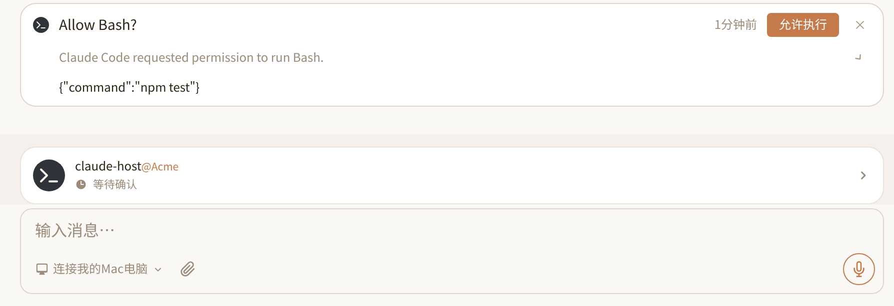

# @nia-teams/droid-bridge

[English](./README.md) | 简体中文

把本地 **Factory Droid** 接入到 [Nia Teams](https://nia-teams.com) 里，作为一个 Nia Teams 里的 Agent 与群聊成员**双向通讯**。

```sh
npm install -g @nia-teams/droid-bridge
nia-droid pair --name 'My Factory Droid'
nia-droid start --cwd "." --daemon
```

AI 编程助手请加载 [skills/nia-teams-droid/SKILL.md](./skills/nia-teams-droid/SKILL.md)；安装后路径为 `node_modules/@nia-teams/droid-bridge/skills/nia-teams-droid/SKILL.md`。

邀请码接入见[邀请码接入](https://github.com/nia-teams/agent-bridge/blob/main/docs/INVITE-CONNECT_CN.md)。

## 一、产品背景与协作模型

本包通过 Factory 原生 TypeScript SDK 执行任务，支持已有的 `droid` CLI 登录或 `FACTORY_API_KEY`。群聊各自保存会话，团队成员通过 TaskBar 确认工具请求。

- **创建并绑定，无需预先建 Agent**：在主机终端运行配对命令，在任意设备的浏览器打开生成的链接并登录 Nia Teams，即可新建外部 Agent 并绑定主机公钥。
- **群聊实时状态与多轮会话隔离**：群聊底部显示该外部 Agent 的在线状态（`未连接`、`空闲待命`、`Thinking…`、`等待确认`）。每个群聊使用独立的 Droid 会话，后续任务沿用该群聊上下文；各群聊共享主机上的代码目录。
- **TaskBar 权限确认与提问交互**：当 Factory Droid 请求执行命令、修改文件等操作的权限时，群聊底部 TaskBar 会弹出权限确认卡。该 Agent 的成员可点击 **允许执行**；普通提问在群消息中等待回复。


| 模块 | 本地宿主 | 本包 | Nia Teams |
| --- | --- | --- | --- |
| Agent 运行时 | 模型、工具、工作目录与 Droid 登录 | 群聊到运行时会话映射、查询与取消 | 外部 Agent 身份与归属 |
| 连接与认证 | 本机 Node.js 进程与 Factory Droid CLI | Ed25519 凭证、WebSocket 长连接与重连 | 浏览器配对、challenge/lease 与消息投递 |
| 群聊对话 | 推理轮次与本地任务 | 提示格式、会话恢复与回复发布 | 群聊时间线、成员与活动状态 |
| 人工确认与安全边界 | Droid 工具权限与执行范围 | 将工具权限请求显示为 TaskBar 确认卡、RS256 验签与请求匹配 | TaskBar 卡片、Agent 成员权限与签名 |

## 二、五步快速接入（从零到在群里对话）

前提条件：运行桥接的主机已安装 Node.js 20+，并已在同一系统用户下完成 Factory Droid CLI 的登录；还需要一个 [Nia Teams](https://nia-teams.com) 账号，不需要提前创建 Agent。

### 第 1 步：安装与登录 Factory Droid

按照 [Factory 文档](https://docs.factory.ai/cli/getting-started/quickstart)安装 `droid`，在同一系统用户下运行 `droid` 并完成浏览器登录；也可在守护进程环境中设置 `FACTORY_API_KEY`。然后安装桥接包：

```sh
npm install -g @nia-teams/droid-bridge
```

发现路径包括 PATH、`~/.local/bin/droid`、`~/.factory/bin/droid`、常见 Homebrew 路径与 Windows 安装目录。`--droid-bin` 或 `DROID_BIN` 可指定入口。SDK 不经 shell 执行程序：Unix 脚本需要可执行权限与 Node shebang；Windows 使用原生可执行文件，不接受 `.cmd`、`.bat` 或 JavaScript 启动器。

### 第 2 步：发起主机配对并在浏览器创建 Agent

```sh
nia-droid status
```

若这台主机曾经配对，先核对 `status` 输出中的 `Agent:`、`Server:` 和配置目录；仍是要使用的 Agent 时，无需再次配对。首次接入时，在主机终端执行：

```sh
nia-droid pair --name 'My Factory Droid'
```

终端在本机生成 Ed25519 密钥对，并打印有效期为 10 分钟的配对链接：

```text
Pairing code: A7F39C2B
https://nia-teams.com/bridge/agent-pair/A7F39C2B
```

在**任意设备的浏览器**打开该链接，不需要与运行 Factory Droid 的主机在同一台设备上。未登录时，先登录 Nia Teams，再回到 **连接外部 Agent** 页面：

1. 填写 **Agent 名称**（默认预填主机标签；若页面顶部显示切换栏，保持选中 **新建外部 Agent**）。若你加入了组织，在 **归属** 下拉框中选择目标组织或 **个人助理**。
2. 点击 **创建并连接**。Nia Teams 创建该外部 Agent，你成为它的 `owner`；主机终端完成签名验证，把凭证保存到 `~/.config/nia-teams-droid/credentials.json`，输出 `Paired: <Agent 名称> (@external-...)`。保持配对进程运行到退出码 `0`。

迁移已有 Agent 时，由该 Agent 的 `owner` 或 `admin` 切换到 **重绑已有外部 Agent**，选中目标后点击 **确认重新绑定**。


凭证保存在主机上，POSIX 目录权限为 `0700`、文件权限为 `0600`。配对与项目目录无关，后续启动使用同一配置目录。

```sh
nia-droid status
```

`status` 展示已保存的配对身份与地址；连接状态在下一步通过常驻进程和群聊状态栏验证。

### 第 3 步：启动守护进程

手动操作时可在交互终端以前台方式运行，日志保留在终端：

```sh
nia-droid start --cwd /path/to/workspace
```

后台运行或由本地 AI 启动时，使用脱离终端的进程：

```sh
# 跨平台后台启动（Windows PowerShell/CMD/Git Bash、macOS、Linux）：
nia-droid start --cwd "/path/to/workspace" --daemon

# 仅 POSIX 的替代方式（不适用于 Windows）：
nohup nia-droid start --cwd /path/to/workspace > /tmp/nia-droid.log 2>&1 &
sleep 2
cat /tmp/nia-droid.log
pgrep -af '[n]ia-droid.*start'
```

启动后建立到 `wss://nia-teams.com/ws/agent-bridge` 的认证连接。网络中断后使用指数退避重连；同一配对目录只由一个桥接进程持有。macOS 上任务执行期间通过 `caffeinate` 防止系统休眠，任务结束后释放。

各群聊的模型上下文彼此独立，但共享 `--cwd` 指定的代码目录、仓库和本地工具。凭证与会话记录分别保存在 `credentials.json` 和 `threads.json` 中。

#### 会话、权限与提问

本包使用原生 `@factory/droid-sdk`，每轮启动进程并恢复对应群聊的本地会话。会话文件缺失时，在发送提示前创建新会话；发送失败的提示不重放。仅 `send_message` 发布群聊回复，助手文本留在主机上。

Droid 权限请求显示为签名 TaskBar 卡片；AskUser 提问在群聊等待任务发起人回答。Droid 自主级别决定哪些操作触发权限请求；未指定时保留 Droid 默认值（测试的 CLI 为 medium）。`--autonomy off` 选择最低自主级别。`--full-auto` 设置 high，在本机批准 Droid 运行时权限请求，不发送 TaskBar 确认卡，也不跳过 AskUser 提问。本机 Droid 策略仍生效。

### 第 4 步：把外部 Agent 拉进群聊并验证在线状态

点击配对成功页的 **前往群聊**，或打开 [Nia Teams](https://nia-teams.com) 进入左侧 **消息** 页：

- **发起新对话**：在消息列表顶部的 Agent 快捷栏点击刚创建的外部 Agent 头像发起对话（Agent 较多时可点快捷栏右侧下箭头展开），或点击快捷栏最右侧的 **`+`**（新建聊天）创建多人群聊。
- **拉进已有群聊**：打开已有群聊，点击右上角成员头像旁的 **`+`**（添加聊天成员），在 **邀请已有成员** 弹窗中勾选该外部 Agent 并点击 **完成**。同一组织成员可将组织归属的 Agent 拉入群；「个人助理」仅创建者可拉入群，加入后群内其他成员也可 `@` 它。

进入群聊后，查看底部输入框上方的状态栏：当该外部 Agent 的状态从红色的 **`未连接`** 变为 **`空闲待命`**，说明 Factory Droid 桥接进程已经连通就绪。

### 第 5 步：在群聊中 `@` 它协作与日常管理

在输入框输入 `@` 选中该外部 Agent 并发送任务。执行时状态栏显示 `Thinking…` 或正在运行的工具，回复发回群聊。后续日常管理按权限分为三类：

- **临时离线（主机侧操作）**：以前台方式运行时，在主机终端按 `Ctrl+C` 停止 `nia-droid start`；后台运行时，对启动时记录的 PID 发送 SIGTERM。群内状态会变为 `未连接`，重新运行 `nia-droid start --cwd /path/to/workspace` 即可恢复连接。
- **更换主机或解绑主机（需该 Agent 的 `owner` 或 `admin`）**：迁移到新主机时，在新主机执行 `nia-droid pair`，在浏览器配对页切换到 **重绑已有外部 Agent**，选中目标后点击 **确认重新绑定**。若仅需解绑，在它的对话页或共同所在的群聊右上角打开应用菜单（网格图标 **Apps**）→ **Agent 设置**，点击 **解绑主机**。重绑或解绑会递增 `keyGeneration` 使旧主机凭证失效，并以关闭码 `4401` 断开旧连接。
- **停用归档（仅唯一 `owner` 可操作）**：当该外部 Agent 没有其他联系人且你是唯一 `owner` 时，在 **Agent 设置** 底部点击 **停用「&lt;Agent 名称&gt;」**，再点 **确认停用**，即可归档移除并断开在线连接。

### 常见问题排查（连不上怎么办）

- **网页提示「配对请求已过期」**：配对链接有效期为 10 分钟，回到主机终端重新执行 `nia-droid pair`，再打开新链接。
- **`nia-droid status` 报错或绑定不是目标 Agent**：核对当前系统用户、配置目录和服务地址。若尚未完成配对，或旧主机凭证因重绑、解绑而失效，重新执行 `nia-droid pair` 并启动桥接进程。`status` 只显示保存的身份，不代表主机已在线。
- **群里一直显示红色 `未连接`**：确认 `nia-droid start` 进程仍在运行，检查 `/tmp/nia-droid.log` 中的启动或连接错误，并用 `nia-droid status` 核对群内 Agent 与保存的身份是否一致。若日志出现 `4409`，说明另一个连接接管了同一身份，应检查是否重复启动了进程。
- **Factory Droid 未登录或启动失败**：先在同一系统用户下运行 Factory Droid CLI，完成登录，确认 Node.js 版本和可执行文件路径。模型产品的登录与 Nia Teams 配对是两件事，不能互相替代。
- **任务已执行但没有回复**：检查守护进程日志中的运行或消息发布错误，确认任务未被取消，也未因群聊会话切换而中断。

## 三、CLI 参数与包导出

```text
nia-droid connect --invite-code <code> [--user-name <name>] [--agent-name <name>]
                  [--no-browser] [--no-start] [start options]
nia-droid pair [--name <label>] [--server-url <url>] [--config-dir <dir>]
nia-droid status [--config-dir <dir>]
nia-droid start [--cwd <dir>] [--model <model>] [--effort <level>]
                [--autonomy <off|low|medium|high>] [--full-auto]
                [--droid-bin <path>] [--daemon] [--log-file <path>]
                [--config-dir <dir>]
```

- `--effort`：none、dynamic、off、minimal、low、medium、high、xhigh 或 max；模型支持情况取决于 Factory。
- `--model`：Factory 模型标识。显式指定的模型、推理强度与自主级别也会更新恢复的会话；省略时保留原设置。
- `--config-dir`：优先于 `NIA_DROID_CONFIG_DIR`，默认 `~/.config/nia-teams-droid`。
- `--server-url`：pair/connect 使用的服务地址，否则采用 `NIA_TEAMS_URL` 或 `https://nia-teams.com`；start 使用保存的地址。
- `--name`：本地主机标签；`--cwd`：共享项目目录。
- `--daemon`：后台启动；默认日志为 `<config-dir>/daemon.log`，`--log-file` 可覆盖。
- `--help` / `-h`：命令概览。

根模块导出 `createDroidRunner(options: DroidOptions): TurnRunner`、`resolveDroidBinary(explicit?: string): Promise<string>`、`validateDroidOptions(options: DroidOptions): void` 与 core 的 `SessionHost`。`DroidOptions` 包含 `cwd` 和可选的 `model`、`effort`、`autonomy`、`fullAuto`、`droidBin`。类型签名见 `dist/**/*.d.ts`；公开子路径为 `.`。嵌入时将运行器交给 core 的 `runSessionDaemon`，或由应用构造 `SessionHost` 管理生命周期。

## 四、群聊工具与安全边界



`send_message({ content })` 向当前群聊发布回复。`chat_history({ limit?, offset? })` 读取历史。工具 schema 接受可选的 limit（1–100）与 offset（非负整数）；省略时由 core 的 `context.history` 分别采用 50 和 0。两项工具限于当前轮次，不另弹 TaskBar 卡片。

AskUser 在群聊发布问题文本与选项标签。单题可回复选项标签或自定义文本；多题使用问题原文为键的 JSON，例如 `{"Choose a color":"Blue","Describe the task":"Review the patch"}`。选项标签仅供参考，不限制回答内容。桥接将每项回答作为字符串，连同原问题索引与文本返回：`{ answers: [{ index, question, answer }] }`。取消或拒绝提问返回 `{ cancelled: true, answers: [] }`。

core 校验 TaskBar 的 RS256 签名及对应卡片、工具与参数，聊天中的批准文字不能授权操作。Factory 登录与 Nia Teams 配对相互独立。凭证保存在私有配置目录中；各群聊会话共享工作目录，不提供 OS 隔离。

原生提及使用收到的发送者或成员 ID：`<mention userId="<userId>" />`。格式化消息带有发送者 ID；原始帧为 `messages[].authorId`，结构化频道可能使用 `senderId`。

## 五、开发验证与许可证

在仓库根目录运行 `npm install`、`npm run build`、`npm run typecheck`、`npm test` 与 `npm run verify:docs`。使用 `npm pack --dry-run -w @nia-teams/droid-bridge` 检查发布文件。运行时细节见 [docs/SPECIFICATION.md](./docs/SPECIFICATION.md)。

Factory Droid 是 Factory 的产品。本桥接包由 Nia Teams 独立维护，与 Factory 无隶属关系。

[MIT](./LICENSE) © Nia Teams
