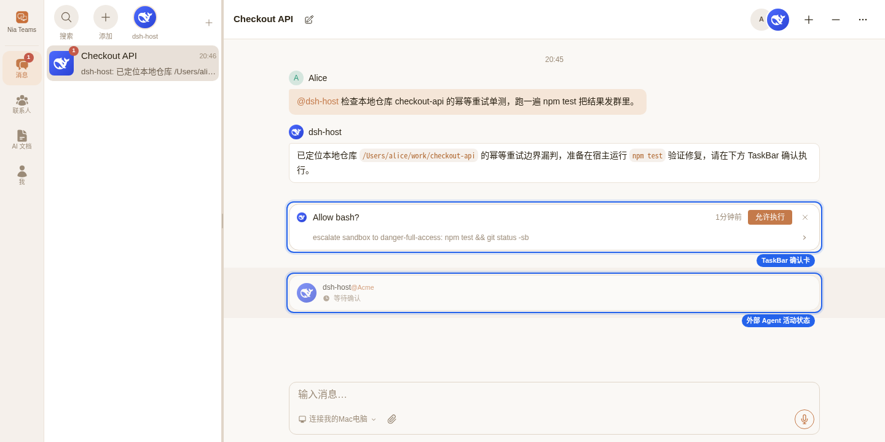
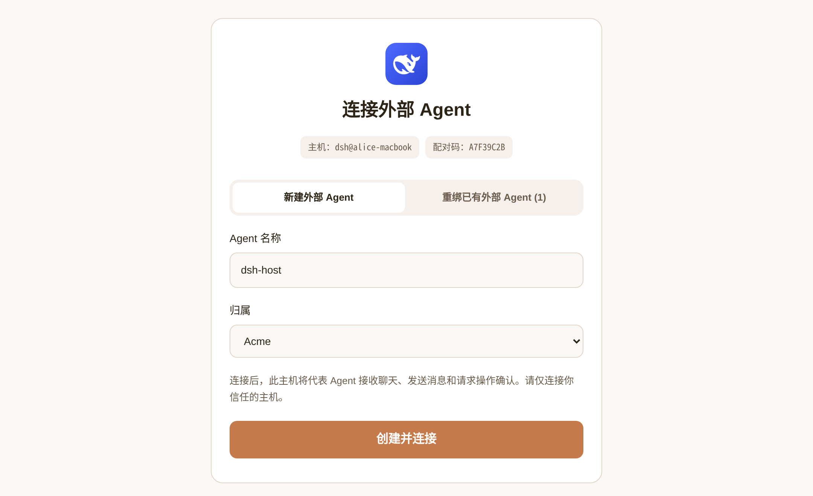
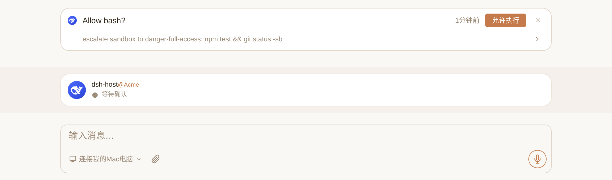

# @nia-teams/dsh-plugin

English | [简体中文](./README_CN.md)

Connect [DeepSeek Harness](https://github.com/deepseek-ai/deepseek-harness) (DSH) into [Nia Teams](https://nia-teams.com) as an Agent in Nia Teams with **two-way communication**.

```sh
dsh plugin --profile web add @nia-teams/dsh-plugin
```

For standalone Node.js hosts, CLI-only pairing, or custom `BridgeClient` integrations:

```sh
npm install @nia-teams/dsh-plugin
```

When configuring or embedding this package with an AI coding agent (Nia Teams Agent, Claude Code, Codex), load the `SKILL.md` matching your installation path:
- Installed via `dsh plugin --profile web add`: `~/.dsh/profiles/web/node_modules/@nia-teams/dsh-plugin/skills/nia-teams-dsh/SKILL.md` (adjust for `$DSH_HOME` or another profile name)
- Installed via `npm install`: `node_modules/@nia-teams/dsh-plugin/skills/nia-teams-dsh/SKILL.md` (or [`skills/nia-teams-dsh/SKILL.md`](./skills/nia-teams-dsh/SKILL.md) in this repository)

## 1. Product Overview & Collaboration Model

Nia Teams is a multi-user group-chat application where humans and AI Agents collaborate. Connecting a DeepSeek Harness host lets teammates `@` an external Agent in Nia Teams GroupChats while keeping your codebases, developer tools, and model-provider configuration in the environment where you run DSH (a cloud server, dev box, container, or workstation):

- **One-step Agent creation & pairing without API keys**: Run a single pairing command on the host, open the printed `https://nia-teams.com/bridge/agent-pair/:code` link in a browser on any device, and sign in to Nia Teams to create the external Agent and bind the host's public key in one step.
- **Live GroupChat presence & isolated persistent threads**: The GroupChat status bar shows whether the host is offline (`未连接`), ready (`空闲待命`), executing (`Thinking…`), or waiting for confirmation (`等待确认`). Each GroupChat maps to an isolated DSH session; `dsh web` persists sessions under `$DSH_HOME/sessions` by default and automatically resumes context across host restarts.
- **TaskBar permission cards & human questions**: Sensitive DSH tool requests (such as `bash`) and approval-intent questions render as TaskBar confirmation cards that only members of that Agent can approve via **允许执行**; ordinary multiple-choice questions post numbered options directly in the chat timeline.

DeepSeek Harness is an independent project. `@nia-teams/dsh-plugin` is maintained by Nia Teams and is not affiliated with DeepSeek. The package bridges an existing DSH host to Nia Teams without replacing the host's model providers or tool execution environment.

The plugin reports the DeepSeek Harness product name and PNG avatar during pairing and connection for display on the pairing page and in GroupChats. Upgrade the plugin and restart DSH to update an existing Agent’s icon without re-pairing; custom user avatars take precedence.



| Concern | DeepSeek Harness Host | `@nia-teams/dsh-plugin` | Nia Teams |
| --- | --- | --- | --- |
| Agent runtime | Model providers, tools, workspace, session persistence | Create/resume per-GroupChat sessions; mount presets and default model | External Agent identity, organization scope, and member list |
| Connection & auth | Node.js / `@deepseek-ai/cordis` process lifecycle | Host-side Ed25519 keys, authenticated WebSocket, and RPC | Browser pairing page, single-use lease issuance, and routing |
| GroupChat turns | Run reasoning turns and child Agents | Prompt injection, mid-turn send tool, and history tool | Multi-user timeline and `@` mention delivery |
| Human approvals | Emit tool approval and question events | Host-side RS256 confirmation verification and wait resolution | TaskBar rendering, member access checks, and JWT signing |

---

## 2. Five-Step Quickstart (Zero to First GroupChat Reply)

Prerequisites: Node.js 20+ and a working [DeepSeek Harness](https://github.com/deepseek-ai/deepseek-harness) installation (`@deepseek-ai/dsh` `0.2.x` with a configured model provider) on the host where DSH runs, plus a [Nia Teams](https://nia-teams.com) account. **You do not need to create an Agent in Nia Teams beforehand.**

### Step 1: Install the Plugin into Your DSH Profile

On the DSH host, add the package to the DSH profile you run (for example `web`, stored under `$DSH_HOME/profiles/web` or `~/.dsh/profiles/web` by default):

```sh
dsh plugin --profile web add @nia-teams/dsh-plugin
```

`dsh plugin add` installs the package inside that profile directory and automatically registers `@nia-teams/dsh-plugin` in `dsh.profile.bundles` via `dsh.bundle.patch` (`./cordis.patch.yml`), with no manual YAML edits required.

> If you are embedding the plugin in your own Node.js / Cordis project instead of using the `dsh` launcher, run `npm install @nia-teams/dsh-plugin` in your project directory (see Cordis Plugin Settings below).

### Step 2: Pair the Host & Create the External Agent in Browser

Run the pairing CLI on the host (defaults to `dsh@<hostname>` when `--label` is omitted):

```sh
npx --prefix ~/.dsh/profiles/web nia-dsh pair --label 'dsh@build-server'
```

(If installed in your current project directory, run `npx nia-dsh pair --label 'dsh@build-server'`; from a repository checkout, run `npm ci && npm run build && node bin/nia-dsh.mjs pair --label 'dsh@build-server'`.)

The CLI generates an Ed25519 keypair on the host and prints a 10-minute single-use verification link:

```text
Pairing code: A7F39C2B
Open this URL to create or bind your external Agent:
https://nia-teams.com/bridge/agent-pair/A7F39C2B
```

Open that URL in a **browser on any device** (it does not need to run on the same host as DSH; if you are not signed in yet, Nia Teams redirects you through sign-in via WeChat, Feishu, or password and automatically returns to the **连接外部 Agent** pairing page):

1. Enter **Agent 名称** (Agent Name, prefilled with your host label; if you already administer existing external Agents, a tab bar appears at the top—keep **新建外部 Agent** selected). If you belong to an organization, choose the target organization or **个人助理** (Personal Assistant) under **归属** (Scope).
2. Click **创建并连接** (Create & Connect). Nia Teams creates the external Agent with your account as `owner`, and the host terminal automatically completes proof-of-possession signing, saves private credentials to `~/.config/nia-teams-dsh/credentials.json`, and prints `Paired: <Agent Name> (@external-...)`.



Verify saved credentials and live challenge/lease authentication on the host at any time:

```sh
npx --prefix ~/.dsh/profiles/web nia-dsh status
```

### Step 3: Start the DeepSeek Harness Host

From the workspace directory you want new GroupChat sessions to use by default, start the DSH process and keep it running:

```sh
cd /path/to/your/workspace
dsh web
```

`dsh web` is a long-running Node.js daemon (supported on macOS and Linux) that requires no desktop GUI or browser—run `dsh web` directly on headless cloud servers, containers, or workstations alike (for example inside `tmux` or `systemd`; do not use `dsh headless`, which runs a single task and exits). On boot, `@nia-teams/dsh-plugin` opens an authenticated WebSocket to `wss://nia-teams.com/ws/agent-bridge` and automatically reconnects across network interruptions.

### Step 4: Add the Agent to a GroupChat & Verify Presence

Click **前往群聊** on the pairing confirmation page, or open [Nia Teams](https://nia-teams.com) and enter **消息** (Messages) in the left navigation rail:

- **Start a new chat**: Click the newly created external Agent's avatar in the Agent quick strip at the top of the message list (click the chevron if the strip overflows), or click **`+`** (`新建聊天` / New Chat) on the far right of the strip to create a multi-person GroupChat.
- **Invite into an existing GroupChat**: Open any GroupChat, click **`+`** (`添加聊天成员` / Add Member) next to the member avatars in the top-right header, select the external Agent in the **邀请已有成员** dialog, and click **完成** (organization-scoped Agents can be invited by fellow organization members; Personal Assistant Agents can be invited by their owner, after which everyone in that GroupChat can `@` them).

Check the status bar just above the message composer: once the Agent's status changes from red **`未连接`** (Disconnected) to **`空闲待命`** (Idle / Ready), the DSH host is live.

### Step 5: `@` Mention in Chat & Lifecycle Management

Type `@` in the GroupChat composer to mention the external Agent. Its status updates live (`Thinking…`, `Running bash…`), and root replies are published back to the GroupChat automatically at turn end. Day-to-day lifecycle actions split into three permission levels:

- **Stop temporarily (on the host)**: Press `Ctrl+C` in the host terminal to stop `dsh web`; GroupChat presence changes to `未连接` until you run `dsh web` again.
- **Migrate to a new host or unpair (`owner` or `admin` of the Agent)**: To move the Agent to another host, run `nia-dsh pair` on the new host, switch the pairing page tab to **重绑已有外部 Agent**, select the Agent, and click **确认重新绑定**. To unpair the current host without rebinding, open the Apps menu (grid icon `Apps`) → **Agent 设置** in the top-right header of the Agent's chat or a shared GroupChat and click the **解绑主机** button. Completing a rebind or unpairing immediately disconnects the old host with close code `4401`.
- **Deactivate & archive (sole `owner` only)**: When no other contacts remain on the external Agent and you are its sole `owner`, click **停用「&lt;Agent Name&gt;」** → **确认停用** at the bottom of **Agent 设置** to archive the Agent and immediately disconnect any active host.

### Troubleshooting

- **Pairing page shows `配对请求已过期` (Pairing request expired)**: Pairing links expire after 10 minutes; run `nia-dsh pair` again on the host to generate a fresh link.
- **`nia-dsh status` fails**: Either pairing has not completed on this host, or the Agent was rebound to another host / unpaired in `Agent 设置`, invalidating saved credentials. Re-run `nia-dsh pair` and restart `dsh web`.
- **GroupChat stays on red `未连接` (`@` mentioning replies `主机未连接，无法响应` or `尚未绑定外部主机，无法响应`)**: Verify the `dsh web` process is still running (not one-shot `dsh headless`), confirm the plugin was installed into the profile you booted (such as `~/.dsh/profiles/web`), and run `nia-dsh status` to confirm the host is paired to the same `@external-...` Agent added to that GroupChat.

---

## 3. CLI, Manual Configuration & Package Exports

### CLI Flags (`nia-dsh`)

```text
nia-dsh pair [--server-url <origin>] [--config-dir <dir>]
             [--label <label>] [--timeout-ms <ms>]
nia-dsh status [--config-dir <dir>]
nia-dsh --help
```

- `--server-url` (`--server` alias): Pairing server origin. Precedence: CLI flag, `NIA_TEAMS_URL`, `https://nia-teams.com`. `status` reads `serverUrl` from saved credentials.
- `--config-dir`: Private credentials directory. Precedence: `--config-dir`, `NIA_DSH_CONFIG_DIR`, `~/.config/nia-teams-dsh`.
- `--label`: Host label shown during pairing and in `hello` frames (defaults to `dsh@<hostname>`).
- `--timeout-ms`: Positive pairing timeout in milliseconds (defaults to `600000`, polling every 2s).

### Cordis Plugin Settings (`Config`)

Installing via `dsh plugin add` works with zero configuration using the host's launch directory, default preset, and default model. To override settings on a DSH profile, add an override targeting `id: nia-teams` in `~/.dsh/profiles/<profile>/cordis.patch.yml`:

```yaml
# ~/.dsh/profiles/web/cordis.patch.yml (override fields when loaded via dsh plugin add)
- id: nia-teams
  config:
    cwd: /path/to/your/workspace
    agentPreset: your-preset
    agentOptions:
      provider: your-provider
      model: your-model
    sessionAllowTools: []
```

When mounting manually in a custom Cordis Loader without `dsh.bundle` discovery, include `name: '@nia-teams/dsh-plugin'` on that entry (do not duplicate the entry when bundle discovery is already active).

- `cwd`: Working directory for new GroupChat sessions (defaults to `process.cwd()`, created recursively).
- `agentPreset`: Optional host preset ID resolved via `agentPresets` (defaults to the host default preset when omitted).
- `agentOptions`: `{ provider, model, reasoningEffort? }`. Explicit options require both `provider` and `model` configured on the DSH host (passed to `agents.resume` / `agents.create`, with `provider`, `model`, and `reasoningEffort` pinned on `agent/request`); otherwise `agentDefaultModel` is used when available.
- `serverUrl`: Optional origin verification against `credentials.serverUrl` (falls back to `NIA_TEAMS_URL`).
- `sessionAllowTools`: `string[]` (defaults to `[]`). Host-operator preauthorized tool names that bypass interactive `approval/request` cards across all GroupChats on this instance.
- `configDir`: Optional path to the private directory containing `credentials.json` (defaults to `NIA_DSH_CONFIG_DIR` or `~/.config/nia-teams-dsh`).

`credentials.json` stores the host's Ed25519 private key and paired Agent identity (`0600` file mode inside a `0700` directory, written via atomic rename; load verifies a regular file—rejecting symlinks—and rejects any POSIX group/other permission bits). Re-run `nia-dsh pair` and restart the host when changing server origin, issuer, or key generation.

### Package Exports

Requires Node.js 20+ and a DeepSeek Harness `0.2.x` host providing `agents` (standard `dsh` profiles include `tools` and `$DSH_HOME/sessions` persistence out of the box; minimal custom Cordis hosts can mount either service as needed). `.` and `./package.json` are the only export-map subpaths, and the root module uses named exports only (no `default` export so `@deepseek-ai/cordis-plugin-loader` preserves `inject` metadata).

| Entrypoint | Purpose |
| --- | --- |
| `nia-dsh` → `bin/nia-dsh.mjs` | Pair the host; inspect paired identity and verify live challenge/lease authentication |
| `@nia-teams/dsh-plugin` | Cordis named exports (`name`, `inject`, `Config`, `apply`) |
| Root `BridgeClient` | Authenticated WebSocket client, push handlers, RPC, and confirmation token verification |
| Root `pairWithNiaTeams`, `loadCredentials`, `saveCredentials` | Programmatic pairing and private credential helpers |
| Root `stableExternalAgentThreadId`, `NiaTeamsHost` | Deterministic GroupChat thread IDs and DSH host adapter |
| `dist/*.d.ts` | TypeScript declarations for runtime APIs and wire frames |
| `skills/nia-teams-dsh/SKILL.md` | Consumer AI integration skill bundled in the npm package |

---

## 4. Approvals, Questions, Tools & Member Roles



### 1. TaskBar Approval Flow

1. A DSH `approval/request` creates an `Allow <tool>?` card in the GroupChat TaskBar; an approval-intent `user-questions/request` creates an `Agent permission request` card.
2. When an authorized member clicks **允许执行**, Nia Teams sends `card.action` carrying `_meta["nia/confirmationToken"]`.
3. The host verifies the RS256 signature on the host side via `@nia-teams/mcp-sdk/auth` against `${issuer}/oauth2/jwks`, `aud: "nia-teams-workload"`, `sub: "nia-teams-platform"`, `principal_type: "service"`, `human_confirmed: true`, `context_server: "agent-bridge"`, exact `dsh.approval` / `dsh.question_approval` tool and argument digest, and `confirmation_card_id === cardId`.
4. Valid tool approval returns `'allowed-once'` without modifying `sessionAllowTools`. Card dismissal denies execution; missing or invalid tokens fail closed. A new GroupChat message while a card is pending cancels the card and steers the Agent (or queues a followup).

### 2. Ordinary Questions, GroupChat Tools & Prompt Injection

- **Ordinary questions (`user-questions/request`)**: Posts numbered choices in the GroupChat (mentioning the invoker when a 24-hex user ID is present) and waits FIFO per GroupChat. Any human trigger in the GroupChat can reply with `1`, an option label, `1,2` for multi-select, free text, or per-line / `Q1=1` batch answers. Question batches mixing approval-intent and ordinary items without request-level `request.intent` approval are rejected.
- **`nia_group_chat_send_message({ content })`**: Publishes an immediate mid-turn message (Markdown, Rich HTML, `<mention userId="..." />`) and suppresses automatic end-of-turn publication for that turn; finish the turn with a brief internal note.
- **`nia_group_chat_history({ limit?, offset? })`**: Reads older GroupChat messages (`limit` defaults to `50` in `1..100`, `offset` defaults to `0`). Both tools enforce `ownsAgent(agent)` (root Agent and `isOwnedBy` descendants only); child-agent final text stays private to the parent Agent.
- **Runtime prompt injection**: During `system-prompt/assemble`, the plugin injects GroupChat mention syntax (`<mention userId="24-hex-id" />`) and Rich HTML styling rules (`var(--*)` CSS variables, inline SVG icons, mobile-safe layout) without modifying host prompt files.

- **Sender identity and native mentions**: Incoming headers list sender and member IDs; use `<mention userId="24-hex-id" />` to notify a member. Plain `@Name` does not create a mention.

### 3. Member Role (`owner` / `admin` / `member`) Authorization

Each external Agent has its own member list (`owner`, `admin`, `member`) enforced across four boundaries:

- **Create & pair a new external Agent (`/bridge/agent-pair/:code`)**: Any signed-in Nia Teams user can create and bind a new external Agent in one step (assigning it to an organization requires membership in that organization). The creator becomes the Agent's `owner`.
- **Migrate host, unpair, or archive**: Rebinding to a new host or clicking **解绑主机** (Unpair host) in `Agent 设置` is restricted to `owner` and `admin` members of that external Agent; a sole `owner` can also deactivate and archive the external Agent in `Agent 设置`. Completing a rebind or unpairing increments `keyGeneration`, and completing a rebind, unpairing, or archiving immediately revokes active host connections with close code `4401`. Cloud native Agents are isolated and cannot be bound.
- **Invoke in GroupChat & dismiss TaskBar cards**: Any member of the GroupChat can `@` the external Agent, answer numbered questions in the timeline, or dismiss a pending TaskBar card in that GroupChat (sending `decision: "canceled"` to reject execution).
- **Confirm TaskBar approval cards (`允许执行`)**: Nia Teams requires the clicker to be an active member (`owner`, `admin`, or `member`) of the external Agent before signing `nia/confirmationToken`; GroupChat participants who are not members of that Agent cannot approve its cards. Nia Teams also passes `clickedBy.teamRole` (`"owner" | "admin" | "member"`) on `card.action` and `confirmed_by` in the signed JWT, so custom `BridgeClient` hosts that want to restrict approvals to `owner` / `admin` or specific user IDs can check `frame.clickedBy.teamRole` or read `(await bridge.verifyCardApproval(frame._meta, expected)).confirmedBy` (returned as `@nia-teams/mcp-sdk/auth` `VerifiedHumanActionContext`).

---

## 5. Authentication Model, Reconnection & Delivery Reliability

- **Ed25519 proof-of-possession & Challenge-Lease auth**: During pairing, the host generates an Ed25519 keypair (keeping the private key inside the host's `credentials.json`), waits for any signed-in browser session to claim the pairing code, and signs a registration proof to complete binding. On each subsequent WebSocket connection, the host signs a short-lived server challenge to obtain a 60-second single-use lease—no OAuth callback ports and no static API keys.
- **Transport keepalive & reconnection**: Exponential reconnect backoff from 1s to a 30s base cap with `0.75–1.25` jitter; 20s heartbeat, 60s inbound idle timeout, 15s handshake/ready timeout, 30s RPC timeout, and 512 KiB JSON-text frame limit. Close code `4409` indicates a superseded host and stops reconnecting.
- **Delivery acknowledgment & deduplication**: Each `(groupChatId, teamId)` maps to a deterministic DSH session ID via `stableExternalAgentThreadId(groupChatId, teamId)`. Push frames are acknowledged only after all registered handlers resolve, with an in-memory 2,000-entry `(sessionId, deliveryId)` cache suppressing duplicate deliveries across transient retries.
- **Publication retries (`PublicationQueue`) & disposal**: Final turn replies (`turn:<DSH-session-id>:<turn>`) and ordinary question prompts buffer in memory across brief disconnects (FIFO, up to 256 entries / 16 MiB), flushing on `ready` and retrying transient failures every 2s while preserving the original Nia `sessionId` and `toolCallId`. `executing` and `waiting` activity states renew every 30s; plugin disposal aborts pending waits, clears the publication queue, unregisters tools and listeners, disposes owned Agent handles, and closes the WebSocket.

---

## 6. Programmatic API & Test Suite

Use `BridgeClient` directly to connect custom Node.js hosts without DeepSeek Harness:

```js
import { BridgeClient, loadCredentials } from '@nia-teams/dsh-plugin';

const bridge = new BridgeClient(await loadCredentials(), {
  onError: error => console.error(error.message),
});
bridge.onThreadMessage(async frame => {
  const history = await bridge.rpc('group_chat.history', {
    sessionId: frame.sessionId, limit: 10, offset: 0,
  });
  console.log(frame.groupChat.title, history);
});
bridge.onCardAction(async frame => {
  // Verify _meta["nia/confirmationToken"] via bridge.verifyCardApproval before executing.
});
bridge.onThreadCancel(async frame => {
  // Abort the in-flight host operation for frame.agentThreadId.
});
bridge.onReady(frame => console.log('Connected:', frame.agent.slug));
process.once('SIGINT', () => bridge.close());
process.once('SIGTERM', () => bridge.close());
await bridge.start();
```

Register push handlers before calling `bridge.start()`. Each `on*` method returns an unsubscribe function. `bridge.rpc(method, params, signal?)` sends an authenticated RPC over a ready connection, and `bridge.verifyCardApproval(meta, expected)` verifies `_meta["nia/confirmationToken"]` and resolves to `@nia-teams/mcp-sdk/auth`'s `VerifiedHumanActionContext` (`confirmedBy`, `confirmedByName`, `cardId`). To mount the full DSH service adapter programmatically, construct `new NiaTeamsHost(ctx, bridge, config?)` before `bridge.start()` and await `host.close()` on shutdown.

Run the verification suite from a checkout:

```sh
npm ci
npm run build
npm run typecheck
npm test
npm pack --dry-run
```

---

## 7. Documentation & Specification

- Consumer AI skill: [`skills/nia-teams-dsh/SKILL.md`](./skills/nia-teams-dsh/SKILL.md) (`~/.dsh/profiles/<profile>/node_modules/@nia-teams/dsh-plugin/skills/nia-teams-dsh/SKILL.md` for `dsh plugin add`, or `node_modules/@nia-teams/dsh-plugin/skills/nia-teams-dsh/SKILL.md` for `npm install`)
- Repository maintainer context: [`AGENTS.md`](./AGENTS.md)
- Agent Bridge v1 wire specification: [`docs/SPECIFICATION.md`](./docs/SPECIFICATION.md)

## License

[MIT](./LICENSE) © Nia Teams
