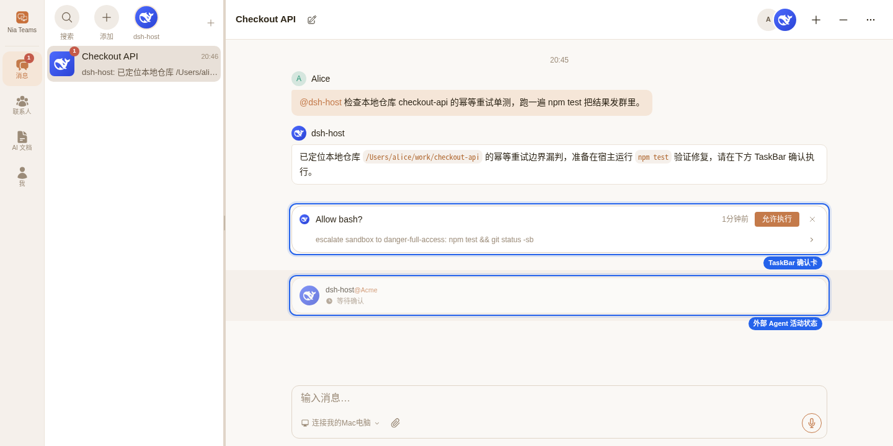
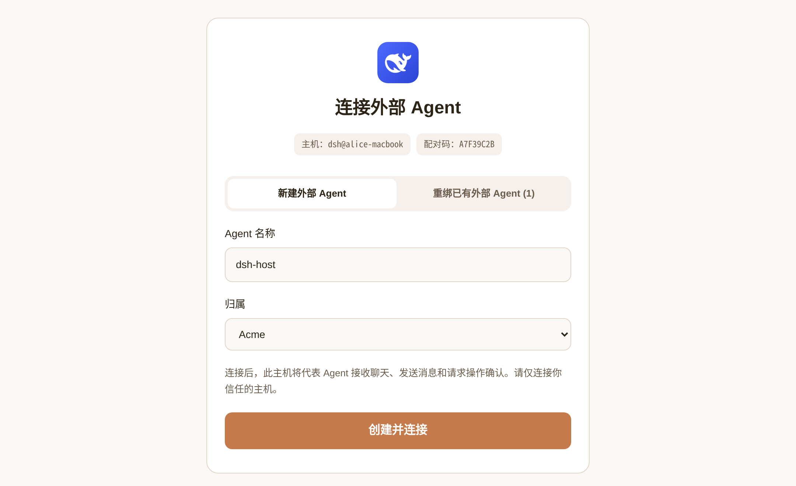
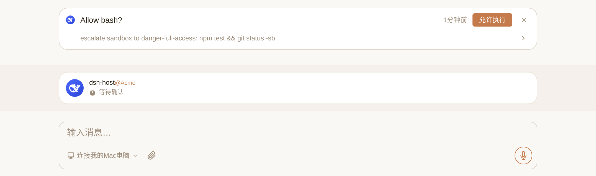

# @nia-teams/dsh-plugin

[English](./README.md) | 简体中文

把 [DeepSeek Harness](https://github.com/deepseek-ai/deepseek-harness)（DSH）接入到 [Nia Teams](https://nia-teams.com) 里，作为一个 Nia Teams 里的 Agent 与群聊成员**双向通讯**。

```sh
dsh plugin --profile web add @nia-teams/dsh-plugin
```

若使用独立 Node.js 进程或仅调用配对 CLI / `BridgeClient` SDK：

```sh
npm install @nia-teams/dsh-plugin
```

使用 AI 编程助手（Nia Teams Agent、Claude Code、Codex 等）配置或集成本包时，请按安装方式加载对应的 `SKILL.md`：
- 通过 `dsh plugin --profile web add` 安装：`~/.dsh/profiles/web/node_modules/@nia-teams/dsh-plugin/skills/nia-teams-dsh/SKILL.md`（若自定义了 `$DSH_HOME` 或其他 profile 名则对应替换）
- 通过 `npm install` 安装：`node_modules/@nia-teams/dsh-plugin/skills/nia-teams-dsh/SKILL.md`（本仓库源码内为 [`skills/nia-teams-dsh/SKILL.md`](./skills/nia-teams-dsh/SKILL.md)）

## 一、产品背景与协作模型

Nia Teams 是人与 AI Agent 共同所在的多人群聊应用。接入 DeepSeek Harness 后，代码库、工具链与模型配置都保留在你运行 DSH 的主机环境中（云服务器、开发机、容器或个人设备均可），同时团队成员可以在 Nia Teams 群聊里直接 `@` 这个外部 Agent 协作：

- **一步创建并绑定，无需预先建 Agent 或配置 API Key**：在主机终端运行一次配对命令，在任意设备的浏览器打开生成的 `https://nia-teams.com/bridge/agent-pair/:code` 链接并登录 Nia Teams，即可当场新建外部 Agent 并完成主机公钥绑定。
- **群聊实时状态与多轮会话隔离**：群聊底部实时展示该外部 Agent 的在线状态（`未连接`、`空闲待命`、`Thinking…`、`等待确认`）。每个群聊自动映射为独立的 DSH 会话；`dsh web` 默认将会话持久化在 `$DSH_HOME/sessions` 下，重启 DSH 进程后自动恢复上下文。
- **TaskBar 权限确认与提问交互**：当 DSH 主机需要执行敏感工具（如 `bash`）或发起审批提问时，群聊底部 TaskBar 会弹出权限确认卡，仅该 Agent 的成员可点击 **允许执行** 下发签名确认凭证；普通选择题则直接发到群消息流等待回复。

DeepSeek Harness 是独立项目。`@nia-teams/dsh-plugin` 由 Nia Teams 维护，与 DeepSeek 无隶属关系。本包仅负责将已有 DSH 主机桥接到 Nia Teams，不改动其模型提供方与工具执行环境。

插件在配对与连接时携带 DeepSeek Harness 产品名称和 PNG 头像，供配对页与群聊展示。已有 Agent 升级插件并重启 DSH 后可更新图标，无需重新配对；用户自定义头像优先。



| 模块 | DeepSeek Harness 主机 | `@nia-teams/dsh-plugin` | Nia Teams |
| --- | --- | --- | --- |
| Agent 运行时 | 模型提供方、工具集、工作区、会话持久化 | 按群聊创建/恢复会话，挂载预设与默认模型 | 外部 Agent 身份、归属组织与成员列表 |
| 连接与认证 | Node.js / `@deepseek-ai/cordis` 进程生命周期 | 主机侧 Ed25519 密钥、WebSocket 长连接与 RPC | 浏览器配对页、短期 lease 签发与消息路由 |
| 群聊对话 | 执行推理轮次与子 Agent | 注入群聊提示词、提供中途发消息与历史读取工具 | 多人消息时间线与 `@` 触发投递 |
| 人工确认与输入 | 发出工具审批与提问事件 | 主机侧校验确认卡 RS256 签名并唤醒等待 | TaskBar 卡片渲染、成员权限门禁与签名 |

---

## 二、五步快速接入（从零到在群里对话）

前提条件：运行 DSH 的主机环境已安装 Node.js 20+ 与可正常运行的 [DeepSeek Harness](https://github.com/deepseek-ai/deepseek-harness)（`@deepseek-ai/dsh` `0.2.x`，且 `dsh` 已配置好模型提供方），并拥有一个 [Nia Teams](https://nia-teams.com) 账号（**不需要**提前在 Nia Teams 里创建 Agent）。

### 第 1 步：把插件装入你的 DSH Profile

在主机上将本包安装到要运行的 DSH profile（例如常用的 `web` profile，位于 `$DSH_HOME/profiles/web`，默认 `~/.dsh/profiles/web`）：

```sh
dsh plugin --profile web add @nia-teams/dsh-plugin
```

`dsh plugin add` 会在该 profile 目录下安装依赖，并自动读取包内的 `dsh.bundle.patch`（`./cordis.patch.yml`）把 `@nia-teams/dsh-plugin` 加入 `dsh.profile.bundles`，无需手动改配置文件。

> 如果你不是通过 `dsh` 启动器运行，而是在自己的 Node.js / Cordis 工程里嵌入本包，则在你自己的工程目录执行 `npm install @nia-teams/dsh-plugin`（详见下文「Cordis 插件配置项」）。

### 第 2 步：发起主机配对并在浏览器创建 Agent

在主机终端执行配对命令（省略 `--label` 时默认使用 `dsh@<hostname>`）：

```sh
npx --prefix ~/.dsh/profiles/web nia-dsh pair --label 'dsh@build-server'
```

（若在当前目录直接安装了本包，运行 `npx nia-dsh pair --label 'dsh@build-server'`；从本仓库源码运行则执行 `npm ci && npm run build && node bin/nia-dsh.mjs pair --label 'dsh@build-server'`。）

终端会在主机侧生成专属的 Ed25519 密钥对，并打印一个 10 分钟内有效的一次性配对链接：

```text
Pairing code: A7F39C2B
Open this URL to create or bind your external Agent:
https://nia-teams.com/bridge/agent-pair/A7F39C2B
```

在**任意设备的浏览器**打开该链接（不需要与运行 DSH 的主机在同一台设备上；未登录时会自动跳转到 Nia Teams 登录页，使用微信、飞书或账号密码登录后会自动跳回 **连接外部 Agent** 页面）：

1. 填写 **Agent 名称**（默认预填你的主机标签；若你名下已有可管理的外部 Agent，页面顶部会显示切换栏，保持选中 **新建外部 Agent** 即可）；若你加入了组织，在 **归属** 下拉框中选择目标组织或 **个人助理**。
2. 点击 **创建并连接**。Nia Teams 会当场创建该外部 Agent（你自动成为它的 `owner`），主机终端随即自动完成签名验证并把私钥与配对身份保存到 `~/.config/nia-teams-dsh/credentials.json`，输出 `Paired: <Agent 名称> (@external-...)`。



你可以随时在主机终端运行以下命令验证凭证与在线握手是否正常：

```sh
npx --prefix ~/.dsh/profiles/web nia-dsh status
```

### 第 3 步：启动 DeepSeek Harness 主机

以你希望 Agent 默认工作的代码目录作为当前目录，启动安装了插件的 DSH 进程并保持运行：

```sh
cd /path/to/your/workspace
dsh web
```

`dsh web` 是常驻 Node.js 进程（目前支持 macOS 与 Linux），不依赖桌面图形界面或浏览器；在无界面的云服务器、容器或开发机上同样直接运行 `dsh web`（可配合 `tmux` 或 `systemd` 后台保活；请勿使用执行单次任务即退出的 `dsh headless`）。进程启动后，插件会自动建立到 `wss://nia-teams.com/ws/agent-bridge` 的认证长连接，断网后自动重连。

### 第 4 步：把外部 Agent 拉进群聊并验证在线状态

点击配对成功页的 **前往群聊**，或打开 [Nia Teams](https://nia-teams.com) 进入左侧 **消息** 页：

- **直接发起新对话**：在消息列表顶部的 Agent 快捷栏点击刚创建的外部 Agent 头像发起对话（Agent 较多时可点快捷栏右侧下箭头展开），或点击快捷栏最右侧的 **`+`**（新建聊天）创建多人群聊。
- **拉进已有群聊**：打开任意已有群聊，点击右上角成员头像旁的 **`+`**（添加聊天成员），在 **邀请已有成员** 弹窗中勾选该外部 Agent 并点击 **完成**（同一组织成员可将组织归属的 Agent 拉入群；「个人助理」仅创建者自己可拉入群，拉入后群内其他成员也可 `@` 它）。

进入群聊后，查看底部输入框上方的状态栏：当该外部 Agent 的状态从红色的 **`未连接`** 变为 **`空闲待命`**，说明 DSH 主机已经连通就绪。

### 第 5 步：在群聊中 `@` 它协作与日常管理

在输入框输入 `@` 选中该外部 Agent 发送任务，状态栏会实时变为 `Thinking…` 或 `Running bash…`，轮次结束时最终回复会自动发回群聊。后续日常管理按权限分为三类：

- **临时离线（主机侧操作）**：在主机终端按 `Ctrl+C` 停止 `dsh web`，群内状态会变为 `未连接`；重新运行 `dsh web` 即恢复 `空闲待命`。
- **更换主机或解绑主机（需该 Agent 的 `owner` 或 `admin`）**：迁移到新主机时，在新主机执行 `nia-dsh pair` 并在浏览器配对页顶部切换到 **重绑已有外部 Agent**，选中目标后点击 **确认重新绑定** 即可替换旧主机；若仅需解绑当前主机，作为该 Agent 成员在它的对话页或共同所在的群聊右上角打开应用菜单（网格图标 `Apps`）→ **Agent 设置**，点击 **解绑主机**。完成重绑或解绑都会以关闭码 `4401` 立即断开旧主机连接。
- **停用归档（仅唯一 `owner` 可操作）**：当该外部 Agent 没有其他联系人且你是唯一 `owner` 时，在 **Agent 设置** 底部点击 **停用「&lt;Agent 名称&gt;」** 并点 **确认停用**，即可将其归档移除并立即断开在线连接。

### 常见问题排查（连不上怎么办）

- **网页提示「配对请求已过期」**：配对链接有效期为 10 分钟，回到主机终端重新执行 `nia-dsh pair` 获取新链接即可。
- **`nia-dsh status` 报错失败**：说明当前主机尚未完成配对，或该 Agent 已迁移重绑到其他主机 / 在网页端点击了 **解绑主机** 导致旧凭证失效；重新执行 `nia-dsh pair` 完成绑定并重启 `dsh web`。
- **群里一直显示红色 `未连接`（`@` 它时回复「主机未连接，无法响应」或「尚未绑定外部主机，无法响应」）**：确认运行 `dsh web` 的进程仍在运行（未使用单次退出的 `dsh headless`），确认插件安装到了实际启动的 profile（如 `~/.dsh/profiles/web`），并用 `nia-dsh status` 核对当前主机绑定的 `@external-...` 与群内是同一个外部 Agent。

---

## 三、CLI、手动配置与包导出

### CLI 参数（`nia-dsh`）

```text
nia-dsh pair [--server-url <origin>] [--config-dir <dir>]
             [--label <label>] [--timeout-ms <ms>]
nia-dsh status [--config-dir <dir>]
nia-dsh --help
```

- `--server-url`（别名 `--server`）：配对服务 origin，优先级为命令行参数、`NIA_TEAMS_URL`、`https://nia-teams.com`。`status` 直接使用凭证中保存的 `serverUrl`。
- `--config-dir`：私有凭证目录，优先级为 `--config-dir`、`NIA_DSH_CONFIG_DIR`、`~/.config/nia-teams-dsh`。
- `--label`：配对页与 `hello` 握手展示的主机标签（默认 `dsh@<hostname>`）。
- `--timeout-ms`：配对等待超时毫秒数（默认 `600000`，每 2 秒轮询一次）。

### Cordis 插件配置项（`Config`）

通过 `dsh plugin add` 安装时无需额外配置即可使用 DSH 宿主的默认工作目录、默认预设与默认模型。若需覆盖，可在对应 profile 的 `~/.dsh/profiles/<profile>/cordis.patch.yml`（或自定义 Cordis Loader 配置）中按 `id: nia-teams` 配置：

```yaml
# ~/.dsh/profiles/web/cordis.patch.yml（已通过 dsh plugin add 自动加载时，只写需覆盖的字段）
- id: nia-teams
  config:
    cwd: /path/to/your/workspace
    agentPreset: your-preset
    agentOptions:
      provider: your-provider
      model: your-model
    sessionAllowTools: []
```

若未使用 `dsh.bundle` 自动发现，而是在自定义 Cordis Loader 中手动挂载插件，则在条目中同时写上 `name: '@nia-teams/dsh-plugin'`（切勿与 bundle 自动发现重复添加两条 `nia-teams`）。

- `cwd`：新建群聊会话的工作目录（默认启动时的 `process.cwd()`，自动递归创建）。
- `agentPreset`：可选预设 ID，通过 Cordis 宿主的 `agentPresets` 服务解析挂载；省略时使用默认预设。
- `agentOptions`：`{ provider, model, reasoningEffort? }`。显式配置时需同时提供已配置的 `provider` 与 `model`（透传给 `agents.resume` / `agents.create`，并在 `agent/request` 固定 `provider`、`model` 与 `reasoningEffort`）；省略时使用 `agentDefaultModel`。
- `serverUrl`：可选服务 origin 校验（未设置时读取 `NIA_TEAMS_URL`，须与配对凭证一致）。
- `sessionAllowTools`：`string[]`（默认 `[]`）。主机操作者显式预授权的工具名列表，对本实例管理的所有群聊免除 `approval/request` 弹窗确认。
- `configDir`：可选私有凭证目录路径（默认读取 `NIA_DSH_CONFIG_DIR` 或 `~/.config/nia-teams-dsh`）。

`credentials.json` 保存主机 Ed25519 私钥与配对身份（目录权限 `0700`、文件权限 `0600`，原子写入；加载时检查常规文件并拒绝符号链接及包含 POSIX group/other 权限位的文件）。更换服务端 origin、issuer 或主机凭证失效后，重新执行 `nia-dsh pair` 并重启进程。重绑或解绑会递增 `keyGeneration` 使旧主机凭证失效。

### 包导出入口

环境要求：Node.js 20+，以及提供 `agents` 服务的 DeepSeek Harness `0.2.x` 宿主（标准 `dsh` profile 已默认挂载 `tools` 与 `$DSH_HOME/sessions` 会话持久化；最小化自定义 Cordis 宿主可按需挂载这两项服务）。package `exports` 子路径仅包含 `.` 与 `./package.json`，且根模块仅使用具名导出（无 `default` 导出，确保 `@deepseek-ai/cordis-plugin-loader` 保留 `inject` 元数据）。

| 入口 | 用途 |
| --- | --- |
| `nia-dsh` → `bin/nia-dsh.mjs` | 主机配对、查看配对身份与验证在线 challenge/lease 认证 |
| `@nia-teams/dsh-plugin` | Cordis 具名导出（`name`、`inject`、`Config`、`apply`） |
| 根入口 `BridgeClient` | 认证 WebSocket 客户端、push handler、RPC 与确认卡 Token 验签 |
| 根入口 `pairWithNiaTeams`、`loadCredentials`、`saveCredentials` | 编程式配对与私有凭证读写 |
| 根入口 `stableExternalAgentThreadId`、`NiaTeamsHost` | 确定性群聊会话 ID 计算与 DSH 宿主适配层 |
| `dist/*.d.ts` | 运行时 API 与协议帧的 TypeScript 类型声明 |
| `skills/nia-teams-dsh/SKILL.md` | 随 npm 包分发的接入方 AI Skill |

---

## 四、权限确认、提问、工具与成员角色



### 1. TaskBar 确认流程

1. DSH 发出 `approval/request` 时，插件在当前群聊 TaskBar 创建 `Allow <tool>?` 确认卡；发出带审批意图的 `user-questions/request` 时，创建 `Agent permission request` 确认卡。
2. 具备权限的成员点击 **允许执行** 后，Nia Teams 下发携带 `_meta["nia/confirmationToken"]` 的 `card.action`。
3. 主机通过 `@nia-teams/mcp-sdk/auth` 基于 `${issuer}/oauth2/jwks` 在主机侧独立校验 RS256 签名、`aud: "nia-teams-workload"`、`sub: "nia-teams-platform"`、`principal_type: "service"`、`human_confirmed: true`、`context_server: "agent-bridge"`、精确的 `dsh.approval` / `dsh.question_approval` 工具名与参数摘要，以及 `confirmation_card_id === cardId`。
4. 工具审批验签通过后向 DSH 返回单次 `'allowed-once'`，不会自动写入 `sessionAllowTools`。忽略卡片拒绝执行；缺失或无效 Token 一律拒绝。等待确认期间若群聊收到新消息，会撤销待确认卡片并 steer Agent（或排入 followup）。

### 2. 普通提问、群聊工具与提示词注入

- **普通提问（`user-questions/request`）**：在群聊中发送编号选项（存在 24 位 hex 用户 ID 时自动 mention 提问触发人），按群聊 FIFO 排队等待。群聊内任何人类成员均可回复 `1`、选项文本、多选 `1,2`、自由文本，或多题逐行 / `Q1=1` 格式作答。混有单题审批意图与普通问题且未在顶层声明 `request.intent` 为审批意图的批次会被拒绝。
- **`nia_group_chat_send_message({ content })`**：立即向当前群聊发布中途消息（支持 Markdown、Rich HTML 与 `<mention userId="..." />`），并抑制该轮结束时的自动最终文本发布；调用后请以简短内部状态词结束当前轮次。
- **`nia_group_chat_history({ limit?, offset? })`**：分页读取群聊历史消息（`limit` 默认 `50`、范围 `1..100`，`offset` 默认 `0`）。两个工具均通过 `ownsAgent(agent)` 限制仅根 Agent 及其 `isOwnedBy` 子孙可调用；子 Agent 的最终文本对父 Agent 保持私有。
- **运行时提示词注入**：插件在 `system-prompt/assemble` 阶段注入群聊 `<mention userId="24-hex-id" />` 语法与 Rich HTML 样式规范（`var(--*)` 主题 CSS 变量、内联 SVG 图标、移动端自适应布局），不修改原有的提示词文件。

- **发送者与原生提及**：传入消息头列出发送者和成员 ID；使用 `<mention userId="24-hex-id" />` 通知成员，纯文本 `@Name` 不触发提及。

### 3. 成员角色（`owner` / `admin` / `member`）权限规则

每个外部 Agent 在 Nia Teams 中拥有独立的成员列表（角色分为 `owner`、`admin`、`member`），在四个边界执行权限校验：

- **一步新建并配对外部 Agent（`/bridge/agent-pair/:code`）**：任何已登录 Nia Teams 的用户均可一步新建并绑定外部 Agent（归属到组织时需为该组织成员），创建者自动成为该外部 Agent 的 `owner`。
- **更换主机重绑、解绑主机与停用归档**：仅该外部 Agent 的 `owner` 或 `admin` 可执行更换主机重绑或在 `Agent 设置` 中点击 **解绑主机**；唯一 `owner` 可在 `Agent 设置` 中停用归档该外部 Agent。完成重绑或执行解绑会递增 `keyGeneration`，而完成重绑、解绑与归档都会立即以关闭码 `4401` 吊销旧主机的在线连接；云端原生 Agent 隔离不可绑定。
- **群聊 `@` 调用与忽略卡片**：群聊内的任何成员均可 `@` 调用外部 Agent、在消息流中回答普通编号提问，或忽略当前群聊的待处理 TaskBar 卡片（向主机发送 `decision: "canceled"` 拒绝执行）。
- **点击 TaskBar「允许执行」确认卡**：Nia Teams 强制校验点击者必须是该外部 Agent 的成员（`owner`、`admin`、`member`）后才签发 `nia/confirmationToken`；非该 Agent 成员即使在同一群聊中也无法批准。同时 Nia Teams 会在 `card.action.clickedBy.teamRole` 中传入点击者角色（`"owner" | "admin" | "member"`）并在签名 JWT 中写入 `confirmed_by`，自定义 `BridgeClient` 客户端如需进一步限制仅 `owner` / `admin` 或特定用户 ID 可审批，可检查 `frame.clickedBy.teamRole`，或读取 `@nia-teams/mcp-sdk/auth` 验签返回的 `(await bridge.verifyCardApproval(frame._meta, expected)).confirmedBy`。

---

## 五、认证机制、重连与投递可靠性

- **Ed25519 配对与 Challenge-Lease 认证**：配对时主机生成 Ed25519 密钥对（私钥仅保存在主机 `credentials.json`），经任意浏览器登录态认领后由主机私钥签署注册证明完成双向绑定。此后每次建立 WebSocket 连接时，主机用私钥对服务端下发的短期随机 challenge 签名，换取 60 秒有效的一次性 lease，全程无 OAuth 回调端口、无静态 API Key 分发。
- **传输保活与重连**：采用 1 秒至 30 秒基数上限的指数退避与 `0.75–1.25` 随机抖动重连；20 秒心跳、60 秒入站空闲超时、15 秒握手/ready 超时、30 秒 RPC 超时，JSON 文本帧上限为 512 KiB。收到关闭码 `4409` 表示已有新主机接管同一 Agent，当前客户端停止重连。
- **投递确认与去重**：每个群聊通过 `stableExternalAgentThreadId(groupChatId, teamId)` 映射为确定性的 DSH 会话 ID。所有注册的 push handler 执行成功后才向服务端发送 `ack`；进程内 2,000 条容量的 `(sessionId, deliveryId)` 缓存用于抑制网络重传产生的重复投递。
- **发布重试队列（`PublicationQueue`）与卸载**：最终轮次回复（`turn:<DSH-session-id>:<turn>`）与普通提问提示在短暂断线期间缓存在内存队列中（FIFO，上限 256 条 / 16 MiB），连接 `ready` 时自动刷新，遇到临时错误每 2 秒重试并保留原始 Nia `sessionId` 与 `toolCallId`。`executing` 与 `waiting` 活动状态每 30 秒续租；插件卸载时终止待处理等待、清空发布队列、注销工具与监听器、销毁所属 Agent handle 并关闭连接。

---

## 六、编程接口与测试验证

不依赖 DeepSeek Harness 时，也可直接使用 `BridgeClient` 在任意 Node.js 进程中接入 Agent Bridge v1：

```js
import { BridgeClient, loadCredentials } from '@nia-teams/dsh-plugin';

const bridge = new BridgeClient(await loadCredentials(), {
  onError: error => console.error(error.message),
});
bridge.onThreadMessage(async frame => {
  const history = await bridge.rpc('group_chat.history', {
    sessionId: frame.sessionId, limit: 10, offset: 0,
  });
  console.log(frame.groupChat.title, history);
});
bridge.onCardAction(async frame => {
  // 执行副作用前先调用 bridge.verifyCardApproval 校验 _meta["nia/confirmationToken"]。
});
bridge.onThreadCancel(async frame => {
  // 取消 frame.agentThreadId 对应的主机侧执行任务。
});
bridge.onReady(frame => console.log('Connected:', frame.agent.slug));
process.once('SIGINT', () => bridge.close());
process.once('SIGTERM', () => bridge.close());
await bridge.start();
```

在调用 `bridge.start()` 前注册所有 push handler（每个 `on*` 方法均返回取消订阅函数）。`bridge.rpc(method, params, signal?)` 在连接 `ready` 时发送认证 RPC，`bridge.verifyCardApproval(meta, expected)` 校验 `_meta["nia/confirmationToken"]` 并返回包含 `confirmedBy`、`confirmedByName`、`cardId` 的 `@nia-teams/mcp-sdk/auth` `VerifiedHumanActionContext`。若在自定义 Cordis 宿主中嵌入完整 DSH 服务适配层，可在 `bridge.start()` 前构造 `new NiaTeamsHost(ctx, bridge, config?)`，退出时等待 `host.close()`。

在源码仓库执行完整校验：

```sh
npm ci
npm run build
npm run typecheck
npm test
npm pack --dry-run
```

---

## 七、文档与协议规范

- 接入方 AI Skill：[`skills/nia-teams-dsh/SKILL.md`](./skills/nia-teams-dsh/SKILL.md)（`dsh plugin add` 安装后位于 `~/.dsh/profiles/<profile>/node_modules/@nia-teams/dsh-plugin/skills/nia-teams-dsh/SKILL.md`，`npm install` 安装后位于 `node_modules/@nia-teams/dsh-plugin/skills/nia-teams-dsh/SKILL.md`）
- 仓库维护者上下文：[`AGENTS.md`](./AGENTS.md)
- Agent Bridge v1 协议规范：[`docs/SPECIFICATION.md`](./docs/SPECIFICATION.md)

## 许可证

[MIT](./LICENSE) © Nia Teams
