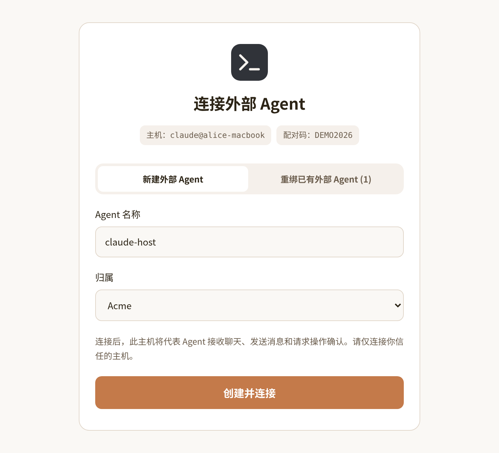

# @nia-teams/pi-bridge

Connect [Pi Coding Agent](https://pi.dev) to [Nia Teams](https://nia-teams.com). The bridge uses your installed `pi` CLI and provider credentials; it does not install a Pi SDK.

```sh
npm install -g @nia-teams/pi-bridge
nia-pi connect --cwd "/path/to/workspace"
```

AI coding agents: load [skills/nia-teams-pi/SKILL.md](./skills/nia-teams-pi/SKILL.md). The npm install path is `node_modules/@nia-teams/pi-bridge/skills/nia-teams-pi/SKILL.md`. To discover the skill inside Pi, run `pi install npm:@nia-teams/pi-bridge`; install the CLI separately for `nia-pi` commands.

## WeChat connect

Use Node.js 20+ for the bridge, and meet your installed Pi release's Node requirement. Run `pi` and set up a model provider under the same OS account that will run the bridge. The bridge supports Pi 1.6.0 and the Pi 0.74.2 release for Node.js 20. See the [RPC compatibility notes](./docs/SPECIFICATION.md#turn-completion) for how it detects turn completion.

Scan the terminal QR code with WeChat and approve the connection. The CLI saves the Agent credentials locally, starts the daemon, and prints a one-time **Handoff URL** for the GroupChat. Keep that URL private. Use `--no-browser` to print it without opening it and `--no-start` if the daemon is already running or should stay stopped.

`--group-link <url-or-token>` joins an existing chat using its `/join/` invite URL or token. Without it, `connect` creates a new chat. Credentials for the selected server are reused without another QR scan. Use `--agent-name` to name a new Agent.

## Browser pairing and rebinding

Check `nia-pi status` for the Agent and server. To bind an existing Agent or pair without WeChat, run `nia-pi pair --name 'My Pi'`. Open the pairing link in a browser on any device and choose whether to create or rebind an external Agent. Wait for `Paired: <Agent name> (@external-...)`. The signing key stays in the local config directory.



## Start and check readiness

After browser pairing or `connect --no-start`, start the daemon when needed:

```sh
nia-pi start --cwd "/path/to/workspace" --daemon
```

Omit `--daemon` to run in the foreground. Check the reported PID and `<config-dir>/daemon.log`, or pass `--log-file <path>` to set a private log file. In Nia Teams, start a new conversation or add the external Agent to an existing GroupChat. Check that it is idle and mention it with a small test task. A running process alone does not establish connectivity.


## Session and tool behavior

Each chat retains its own local Pi session under `<config-dir>/sessions`. Chats still share the chosen workspace and OS account. A missing or unloadable session can be replaced before the prompt; a submitted prompt is never replayed. Pi's assistant output stays on the host. Use `send_message` to publish replies and `chat_history` to read earlier messages. For a notification, use `<mention userId="<userId>" />` with a received sender or member ID (`messages[].authorId` in raw frames, `senderId` in structured channels).

The bridge leaves Pi's native tool permissions in place. It does not add TaskBar approval for Pi runtime tools. Interactive dialogs from installed extensions are canceled in headless mode. Start only in a workspace you trust; limit the host account's permissions and control who can invoke the external Agent.

## Options and troubleshooting

- `--config-dir` overrides `NIA_PI_CONFIG_DIR`; the default is `~/.config/nia-teams-pi`. Run one daemon per config directory.
- `--pi-bin` overrides `PI_BIN`, then discovery through `PATH` and common install locations. JavaScript entrypoints use the bridge's Node executable; use a Node version supported by Pi too.
- `--model <pattern>` selects a Pi model. `--provider <name>` requires `--model`. `--thinking` accepts `off`, `minimal`, `low`, `medium`, `high`, `xhigh`, or `max`. Omit them to let Pi choose.
- If pairing expires, run `nia-pi pair` again. If the chat remains disconnected, check the daemon log, saved server, Agent identity and whether another host is using the same credentials. If a turn fails at startup, verify Pi's provider login, binary and supported RPC events.
- Stop the daemon to go temporarily offline. Rebind from the replacement host when moving machines; remove or archive the external Agent in Nia Teams when retiring it. Preserve the config directory only if you need its pairing and local session history.

## Embedding and development

The package exports `createPiRunner(options)`, `validatePiOptions(options)`, `resolvePiBinary(explicit?)`, `PI_BRANDING`, and core `SessionHost`. See [the adapter specification](./docs/SPECIFICATION.md) for the RPC and tool lifecycle.
