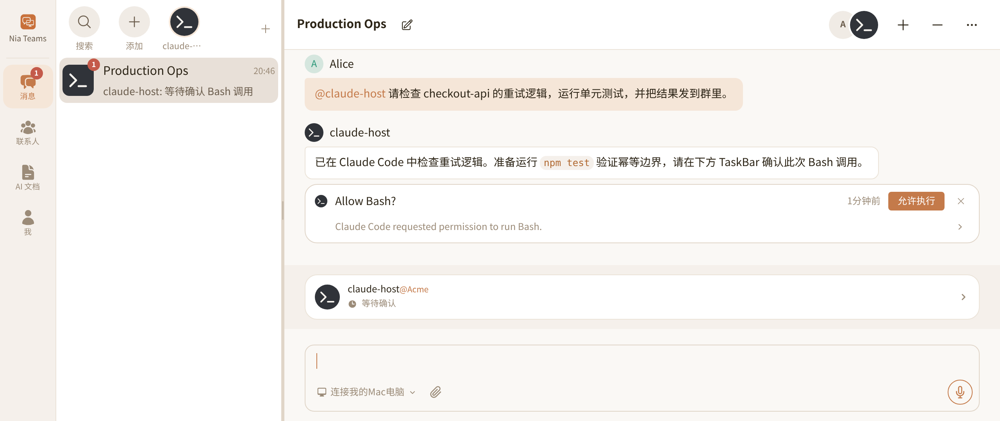

# @nia-teams/pi-bridge

将 [Pi Coding Agent](https://pi.dev) 接入 [Nia Teams](https://nia-teams.com)。桥接程序使用本机已安装的 `pi` 命令和模型登录配置，不会安装 Pi SDK。

```sh
npm install -g @nia-teams/pi-bridge
nia-pi connect --cwd "/path/to/workspace"
```

供 AI 编码助手使用：[skills/nia-teams-pi/SKILL.md](./skills/nia-teams-pi/SKILL.md)。npm 安装后的路径是 `node_modules/@nia-teams/pi-bridge/skills/nia-teams-pi/SKILL.md`。在 Pi 内运行 `pi install npm:@nia-teams/pi-bridge` 即可发现该技能；`nia-pi` 命令需另行安装。

## 微信扫码接入

桥接程序需要 Node.js 20 或更新版本，也请满足所安装 Pi 版本的 Node.js 要求。桥接程序支持 Pi 1.6.0，也支持面向 Node.js 20 的 Pi 0.74.2；两者如何判定任务结束，见 [RPC 兼容说明](./docs/SPECIFICATION.md#turn-completion)。用运行桥接程序的同一个系统账号启动 `pi`，配置好模型服务。

使用微信扫描终端二维码并确认连接。命令会在本机保存 Agent 凭证、启动后台进程，并输出用于打开群聊的一次性 **Handoff URL**。请勿分享该链接。`--no-browser` 只输出链接，不打开浏览器；后台进程已运行或暂不需要启动时，使用 `--no-start`。

`--group-link <url-or-token>` 接受 `/join/` 邀请链接或对应令牌，可加入已有群聊。不传则新建群聊。已有目标服务器的凭证时，无需再次扫码。可用 `--agent-name` 为新 Agent 命名。

## 浏览器配对与重新绑定

先运行 `nia-pi status` 核对 Agent 和服务器。要绑定已有 Agent，或不使用微信配对，请运行 `nia-pi pair --name 'My Pi'`。用任意设备的浏览器打开配对链接，登录 Nia Teams，选择「新建外部 Agent」或重新绑定现有 Agent，再等待终端输出 `Paired: <Agent 名称> (@external-...)`。签名私钥保存在本机配置目录中。


## 启动与检查连接

通过浏览器配对或使用 `connect --no-start` 后，按需启动后台进程：

```sh
nia-pi start --cwd "/path/to/workspace" --daemon
```

去掉 `--daemon` 可在前台运行。后台启动后，检查输出中的 PID 和 `<config-dir>/daemon.log`；可通过 `--log-file <path>` 指定私有日志路径。在 Nia Teams 中用外部 Agent 发起新对话，或把它拉进已有群聊。确认 Agent 显示空闲后，@ 它试发一个简单任务。进程存在并不代表已连上 Nia Teams。



## 会话与工具权限

每个群聊在 `<config-dir>/sessions` 下保存独立的 Pi 会话，但共用选定的工作目录和系统账号。会话文件丢失或无法加载时，可在发送提示词前新建会话；已经提交的提示词不会重发。Pi 的助手输出留在主机上。通过 `send_message` 将回复发到群里，用 `chat_history` 读取历史消息。要提醒某人，请从消息或成员列表取用真实 ID，并写成 `<mention userId="<userId>" />`。原始消息的发送者字段为 `messages[].authorId`，结构化频道可使用 `senderId`。

桥接程序保留 Pi 原有的工具权限，不为 Pi 工具新增 TaskBar 审批。后台运行时，扩展发起的交互对话框会被取消。请使用可信工作目录，限制运行账号的权限，并控制哪些成员可以调用外部 Agent。

## 启动选项

- `--config-dir` 优先于 `NIA_PI_CONFIG_DIR`，默认路径为 `~/.config/nia-teams-pi`。每个配置目录只运行一个后台进程。
- `--pi-bin` 优先于 `PI_BIN`；未设置时会在 `PATH` 和常见安装位置查找。若 Pi 的入口是 JavaScript，桥接程序会使用当前 Node.js 来运行它，因此该版本也需要满足 Pi 的要求。
- `--model <pattern>` 选择模型；`--provider <name>` 须与 `--model` 一起使用。`--thinking` 支持 `off`、`minimal`、`low`、`medium`、`high`、`xhigh` 和 `max`。省略时由 Pi 决定。

## 常见问题排查

- 配对链接过期：重新运行 `nia-pi pair`。
- 群聊显示离线：检查后台日志、已保存的服务器和 Agent 身份，并确认没有其他进程占用同一凭证。
- Pi 无法启动：检查模型登录、可执行文件及 Pi 版本所支持的 RPC 事件。
- 临时离线：停止后台进程即可。更换主机或解绑主机：在新主机上重新配对，或在 Nia Teams 中解绑原主机。停用归档：在 Nia Teams 中移除或归档外部 Agent。

## 嵌入与开发

包入口导出 `createPiRunner(options)`、`validatePiOptions(options)`、`resolvePiBinary(explicit?)`、`PI_BRANDING` 和核心包的 `SessionHost`。RPC 与工具生命周期见[适配器规范](./docs/SPECIFICATION.md)。
